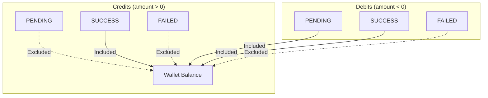
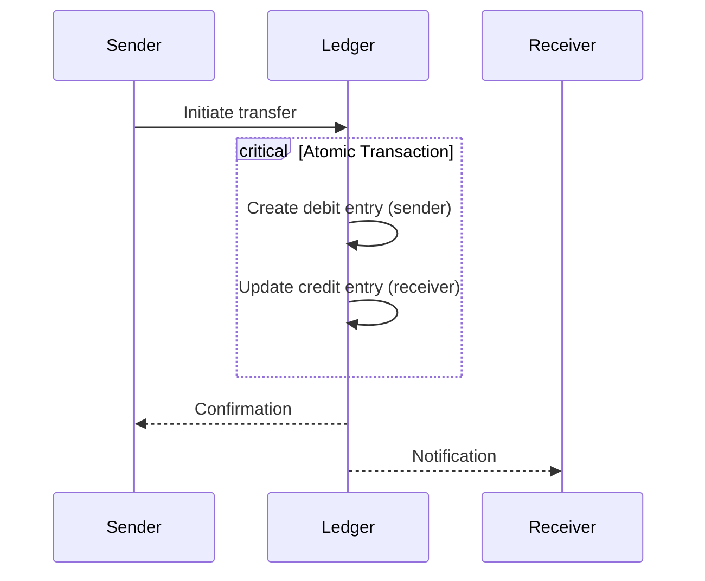
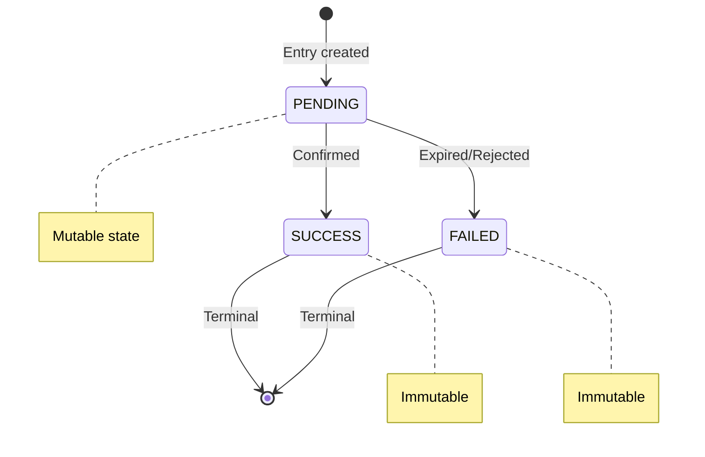

# Lightning Wallet Ledger Specification

:::info Draft Proposal
This specification documents the LNbits ledger system as a potential standard for Lightning Network wallet accounting. It aims to provide a common framework for balance tracking, payment recording, and audit trails across Lightning wallet implementations.
:::

## Abstract

This document specifies a standardized ledger system for Lightning Network wallets. It defines data structures, balance calculation rules, and accounting principles that enable interoperability, auditability, and consistency across wallet implementations.

## Motivation

Lightning Network wallets currently implement accounting in various incompatible ways:
- No standard schema for payment records
- Inconsistent balance calculation methods
- Limited audit trail capabilities
- No standard for internal transfers

A standardized ledger enables:
- **Portability**: Export/import between wallet implementations
- **Auditability**: Consistent audit trails for compliance
- **Interoperability**: Shared tooling for analytics and reporting
- **Correctness**: Well-defined balance calculation rules

## Specification

### 1. Core Concepts

#### 1.1 Ledger Entry

A ledger entry represents a single financial event (payment, transfer, fee).

```typescript
interface LedgerEntry {
  // Identification
  id: string;                    // Unique entry identifier
  payment_hash: string;          // BOLT11 payment hash (32 bytes hex)
  wallet_id: string;             // Associated wallet

  // Amounts (millisatoshis)
  amount_msat: bigint;           // Signed: positive=credit, negative=debit
  fee_msat: bigint;              // Fee amount (always <= 0)

  // State
  status: EntryStatus;           // pending | success | failed
  entry_type: EntryType;         // Type classification

  // Metadata
  memo: string | null;           // Human-readable description
  bolt11: string | null;         // BOLT11 invoice string
  preimage: string | null;       // Payment preimage (proof)

  // Timestamps (ISO 8601)
  created_at: string;
  updated_at: string;
  expires_at: string | null;     // For pending invoices

  // Extensibility
  extra: Record<string, unknown>; // Application-specific data
}
```

#### 1.2 Entry Status

```typescript
enum EntryStatus {
  PENDING = "pending",   // Awaiting confirmation
  SUCCESS = "success",   // Confirmed/settled
  FAILED = "failed"      // Expired, rejected, or error
}
```

#### 1.3 Entry Type

```typescript
enum EntryType {
  // Standard Lightning
  INVOICE = "invoice",           // Incoming invoice (amount > 0)
  PAYMENT = "payment",           // Outgoing payment (amount < 0)

  // Internal
  INTERNAL_CREDIT = "internal_credit",  // Internal transfer received
  INTERNAL_DEBIT = "internal_debit",    // Internal transfer sent

  // Fees
  SERVICE_FEE = "service_fee",   // Operator service fee
  ROUTING_FEE = "routing_fee",   // Network routing fee

  // Adjustments
  CREDIT = "credit",             // Manual credit (admin)
  DEBIT = "debit",               // Manual debit (admin)

  // Swaps
  SWAP_IN = "swap_in",           // On-chain to Lightning
  SWAP_OUT = "swap_out"          // Lightning to on-chain
}
```

### 2. Balance Calculation

#### 2.1 Balance Formula

The wallet balance MUST be calculated as:

```
balance = Σ (amount_msat + fee_msat) for all qualifying entries
```

Where qualifying entries are determined by asymmetric status rules.

#### 2.2 Asymmetric Status Rules



| Direction | Status | Include in Balance? | Rationale |
|-----------|--------|---------------------|-----------|
| Credit (amount > 0) | PENDING | No | Don't count unconfirmed income |
| Credit (amount > 0) | SUCCESS | Yes | Confirmed income |
| Credit (amount > 0) | FAILED | No | Never received |
| Debit (amount < 0) | PENDING | Yes | Reserve funds immediately |
| Debit (amount < 0) | SUCCESS | Yes | Confirmed expense |
| Debit (amount < 0) | FAILED | No | Refund reserved funds |

#### 2.3 SQL Reference Implementation

```sql
CREATE VIEW wallet_balances AS
SELECT
    wallet_id,
    COALESCE(SUM(amount_msat + fee_msat), 0) AS balance_msat
FROM ledger_entries
WHERE (
    -- Credits: only SUCCESS
    (amount_msat > 0 AND status = 'success')
    OR
    -- Debits: SUCCESS or PENDING (reserve immediately)
    (amount_msat < 0 AND status IN ('success', 'pending'))
)
GROUP BY wallet_id;
```

### 3. Internal Transfers

#### 3.1 Definition

An internal transfer occurs when both sender and receiver exist within the same ledger system.

#### 3.2 Identification

Internal transfers MUST be identifiable via:

```typescript
// Entry ID format for internal transfers
id = `internal_${payment_hash}`
```

Or via entry type:
```typescript
entry_type IN ('internal_credit', 'internal_debit')
```

#### 3.3 Atomicity

Internal transfers MUST be atomic:



Both entries succeed or both fail. Partial completion is not permitted.

#### 3.4 Internal Transfer Properties

| Property | Value |
|----------|-------|
| Routing fee | 0 (no network routing) |
| Settlement time | Instant |
| Status | Both entries set to SUCCESS atomically |

### 4. Fee Handling

#### 4.1 Fee Types

```typescript
interface FeeBreakdown {
  routing_fee_msat: bigint;      // Network routing cost
  service_fee_msat: bigint;      // Operator percentage
  reserve_fee_msat: bigint;      // Pre-payment hold (refundable)
}
```

#### 4.2 Fee Recording

Fees MUST be recorded in the `fee_msat` field as negative values:

```typescript
// Outgoing payment example
{
  amount_msat: -10000000n,     // 10,000 sats sent
  fee_msat: -100000n,          // 100 sats total fees
  // Net deduction: 10,100 sats
}
```

#### 4.3 Service Fee Accounting

When service fees are collected, a separate entry MUST be created:

```typescript
// Fee collection wallet receives
{
  id: `service_fee_${payment_hash}`,
  wallet_id: fee_collection_wallet_id,
  amount_msat: 50000n,         // Positive: income
  fee_msat: 0n,
  entry_type: "service_fee",
  status: "success"
}
```

### 5. Entry Lifecycle

#### 5.1 State Transitions



#### 5.2 Immutability Rules

| Status | Mutable Fields | Immutable Fields |
|--------|---------------|------------------|
| PENDING | status, updated_at, preimage | All others |
| SUCCESS | None (fully immutable) | All |
| FAILED | None (fully immutable) | All |

#### 5.3 Update Timestamp

`updated_at` MUST be set whenever any field changes.

### 6. Extensibility

#### 6.1 Extra Field

The `extra` field provides schema-less extensibility:

```typescript
extra: {
  // Application identification
  tag: "tpos",
  extension_id: "tpos_abc123",

  // Fiat tracking
  fiat_amount: 10.50,
  fiat_currency: "USD",
  exchange_rate: 95238.10,

  // Custom data
  order_id: "ORD-12345",
  customer_email: "user@example.com"
}
```

#### 6.2 Reserved Keys

The following keys are reserved for future standardization:

| Key | Purpose |
|-----|---------|
| `tag` | Application/extension identifier |
| `fiat_*` | Fiat currency tracking |
| `lnurl_*` | LNURL protocol metadata |
| `nostr_*` | Nostr integration data |

### 7. Serialization

#### 7.1 JSON Representation

```json
{
  "id": "abc123def456",
  "payment_hash": "a1b2c3d4e5f6...",
  "wallet_id": "wallet_xyz",
  "amount_msat": 10000000,
  "fee_msat": -100000,
  "status": "success",
  "entry_type": "payment",
  "memo": "Coffee payment",
  "bolt11": "lnbc100n1p...",
  "preimage": "0123456789abcdef...",
  "created_at": "2025-01-25T12:00:00Z",
  "updated_at": "2025-01-25T12:00:05Z",
  "expires_at": null,
  "extra": {
    "tag": "tpos",
    "fiat_amount": 5.00,
    "fiat_currency": "USD"
  }
}
```

#### 7.2 Export Format

For ledger portability, implementations SHOULD support JSON Lines (.jsonl) export:

```jsonl
{"id":"entry1","payment_hash":"abc...","amount_msat":10000000,...}
{"id":"entry2","payment_hash":"def...","amount_msat":-5000000,...}
```

### 8. Audit Requirements

#### 8.1 Mandatory Audit Fields

Every entry MUST include:
- `id`: Unique, immutable identifier
- `created_at`: Entry creation timestamp
- `updated_at`: Last modification timestamp

#### 8.2 Audit Trail

Implementations SHOULD maintain:
- Full history of status changes
- Actor identification for manual adjustments
- IP/session data for security-relevant operations

#### 8.3 Reconciliation

The sum of all wallet balances MUST NOT exceed the funding source balance:

```
Σ wallet_balances ≤ funding_source_balance
```

Implementations MUST provide reconciliation tooling.

### 9. Reference Implementation

The LNbits project provides a reference implementation:
- Repository: [github.com/lnbits/lnbits](https://github.com/lnbits/lnbits)
- Key files:
  - `lnbits/core/models/payments.py` - Entry model
  - `lnbits/core/crud/payments.py` - CRUD operations
  - `lnbits/core/migrations.py` - Database schema

### 10. Compatibility

#### 10.1 Minimum Requirements

Implementations claiming compatibility MUST:
1. Implement the `LedgerEntry` structure
2. Follow asymmetric balance calculation rules
3. Support all `EntryStatus` values
4. Handle internal transfers atomically
5. Maintain immutability for terminal states

#### 10.2 Optional Features

| Feature | Status |
|---------|--------|
| Service fees | Optional |
| Fiat tracking | Optional |
| Audit logging | Recommended |
| Export format | Recommended |

## Security Considerations

1. **Amount Overflow**: Use 64-bit integers for millisatoshi amounts
2. **Race Conditions**: Ensure atomic balance checks before debits
3. **Replay Protection**: Payment hash uniqueness per wallet
4. **Access Control**: Separate read/write permissions per wallet

## Appendix A: SQL Schema

```sql
CREATE TABLE ledger_entries (
    id TEXT PRIMARY KEY,
    payment_hash TEXT NOT NULL,
    wallet_id TEXT NOT NULL,
    amount_msat BIGINT NOT NULL,
    fee_msat BIGINT NOT NULL DEFAULT 0,
    status TEXT NOT NULL DEFAULT 'pending',
    entry_type TEXT NOT NULL,
    memo TEXT,
    bolt11 TEXT,
    preimage TEXT,
    created_at TIMESTAMP NOT NULL DEFAULT CURRENT_TIMESTAMP,
    updated_at TIMESTAMP NOT NULL DEFAULT CURRENT_TIMESTAMP,
    expires_at TIMESTAMP,
    extra TEXT,  -- JSON

    UNIQUE (wallet_id, payment_hash, entry_type)
);

CREATE INDEX idx_ledger_wallet_status ON ledger_entries(wallet_id, status);
CREATE INDEX idx_ledger_payment_hash ON ledger_entries(payment_hash);
CREATE INDEX idx_ledger_created_at ON ledger_entries(created_at);
```

## Appendix B: Balance Verification

```python
def verify_balance(wallet_id: str, expected_balance_msat: int) -> bool:
    """Verify wallet balance matches expected value."""
    entries = get_entries(wallet_id)

    calculated = sum(
        entry.amount_msat + entry.fee_msat
        for entry in entries
        if (
            (entry.amount_msat > 0 and entry.status == "success")
            or (entry.amount_msat < 0 and entry.status in ("success", "pending"))
        )
    )

    return calculated == expected_balance_msat
```

## Appendix C: Comparison with Traditional Accounting

| Aspect | This Spec | Double-Entry |
|--------|-----------|--------------|
| Entries per transaction | 1 (signed amount) | 2 (debit + credit) |
| Balance calculation | SUM with status filter | Account totals |
| Audit trail | Timestamps + extra | Journal entries |
| Complexity | Low | High |
| Use case | Wallet systems | Full accounting |

## See Also

- [Ledger System](/docs/architecture/ledger) - LNbits implementation details
- [Payments Architecture](/docs/architecture/payments) - Payment flow documentation
- [BOLT 11](https://github.com/lightning/bolts/blob/master/11-payment-encoding.md) - Invoice specification
