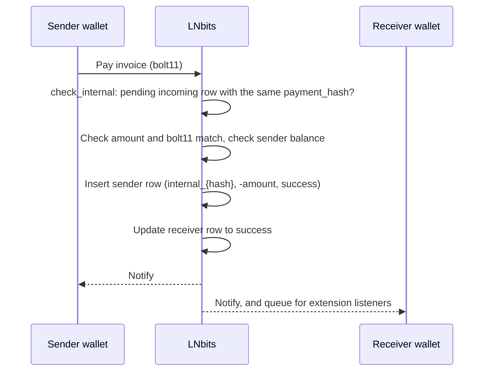
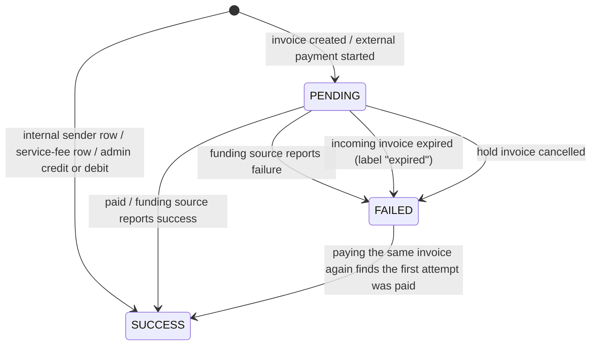

# Ledger System

LNbits has no accounts table and no stored balances. Every invoice and payment is one row in `apipayments`, and a wallet's balance is a SQL view over those rows. This page explains the rules that turn rows into balances, and where they bend. It describes v1.6.2 (`lnbits/core/migrations.py`, `lnbits/core/services/payments.py`, `lnbits/core/crud/payments.py`). For how rows are created, see [Payments](/docs/architecture/payments).

## Design {#design-philosophy}

- One table, `apipayments`, one row per payment. No double-entry bookkeeping and no debit/credit columns.
- `amount` is signed millisatoshis: positive for incoming, negative for outgoing.
- Fees go in a separate `fee` column.
- Balances are computed by the `balances` view each time a wallet is read.

## Database schema {#database-schema}

### The `apipayments` table {#payments-table}

The table was built up by migrations m001 to m045. Its columns in v1.6.2 are equivalent to:

```sql
-- Not a literal CREATE statement: the columns as they stand after all migrations.
apipayments (
    checking_id    TEXT NOT NULL,      -- id used to check status with the funding source
    payment_hash   TEXT,               -- BOLT11 payment hash
    wallet_id      TEXT NOT NULL,
    amount         BIGINT NOT NULL,    -- signed millisatoshis
    fee            INTEGER NOT NULL DEFAULT 0,  -- millisatoshis, usually negative
    bolt11         TEXT,
    preimage       TEXT,
    status         TEXT DEFAULT 'pending',      -- pending / success / failed
    memo           TEXT,
    time           TIMESTAMP NOT NULL,
    expiry         TIMESTAMP,
    webhook        TEXT,
    webhook_status TEXT,
    tag            TEXT,
    extension      TEXT,
    fiat_provider  TEXT,
    labels         TEXT,
    external_id    TEXT,
    created_at     TIMESTAMP,
    updated_at     TIMESTAMP,
    extra          TEXT,               -- JSON
    UNIQUE (wallet_id, checking_id)
)
```

There is no primary key column. The old boolean `pending` column was dropped in m024; `status` replaced it in m021.

### Key fields {#key-fields}

- `checking_id` identifies the row. The code looks rows up by `checking_id` alone, and `create_payment` refuses a second row with the same one in any wallet.
- `status` is the only state. There is no history of how it changed.
- `expiry` is when an incoming invoice expires. Expired pending invoices are marked `failed`.

## Balance calculation {#balance-calculation}

The `balances` view, as last defined in migration `m025_refresh_view`:

```sql
CREATE VIEW balances AS
SELECT apipayments.wallet_id,
       SUM(apipayments.amount - ABS(apipayments.fee)) AS balance
FROM wallets
LEFT JOIN apipayments ON apipayments.wallet_id = wallets.id
WHERE (wallets.deleted = false OR wallets.deleted is NULL)
AND (
    (apipayments.status = 'success' AND apipayments.amount > 0)            -- incoming: only once paid
    OR (apipayments.status IN ('success', 'pending') AND apipayments.amount < 0)  -- outgoing: at once
)
GROUP BY apipayments.wallet_id
```

`get_wallet` reads it as `COALESCE((SELECT balance FROM balances ...), 0) AS balance_msat`. Deleted wallets drop out of the view.

### Balance rules {#balance-rules}

| Direction | Status | Counted? |
|-----------|--------|----------|
| Incoming | `pending` | No |
| Incoming | `success` | Yes: `amount - ABS(fee)` |
| Incoming | `failed` | No |
| Outgoing | `pending` | Yes: `amount - ABS(fee)`, with the fee reserve still in `fee` |
| Outgoing | `success` | Yes: `amount - ABS(fee)`, with the real fee |
| Outgoing | `failed` | No: the amount and the fee are available again |

Outgoing payments count while pending so that money in flight can't be spent twice. The other half of that protection is a per-wallet `asyncio` lock around the balance check and the insert (`wallets_payments_lock` in `services/payments.py`). The lock only works inside one process, so run a single LNbits process per database.

## Internal transfers {#internal-transfers}

When the invoice being paid was issued by the same instance, no Lightning payment is made:



### Properties {#internal-payment-characteristics}

- The **sender** row gets `checking_id = internal_{payment_hash}`. The receiver row keeps its original `checking_id`.
- No routing fee and no fee reserve. A service fee is charged only if `LNBITS_SERVICE_FEE_IGNORE_INTERNAL=false`.
- No funding source call, so internal payments work even with `VoidWallet`.
- **Not atomic.** Every statement commits on its own (`Connection.execute` in `lnbits/db.py` commits after each one). The sender row is committed before the receiver row is updated. If the process dies between the two, the sender is debited and the receiver's invoice is still pending.

### Example {#ledger-entries-for-internal-transfer}

```
Receiver wallet: +10,000,000 msat (incoming row, now success)
Sender wallet:   -10,000,000 msat (internal_ row, success)
Instance total:            0 msat
```

## Fees {#fee-handling}

### Kinds of fee {#fee-types}

- **Fee reserve.** Held in `fee` while an external payment is pending, and passed to the funding source as the routing fee limit.
- **Routing fee.** What the funding source reports it actually paid. It replaces the reserve on success.
- **Service fee.** An optional operator fee, added to the sender's `fee` and credited to the fee wallet as a separate `service_fee_{payment_hash}` row.

The reserve and the service fee are charged **on top of** the amount.

### Fee sign {#fee-sign}

| Row | Stored `fee` |
|-----|--------------|
| External outgoing, pending | `-(reserve + service fee)` |
| External outgoing, success | `-(routing fee + service fee)` |
| Internal outgoing (sender) | `-(service fee)`, usually 0 |
| Incoming, when created | `-abs(fee)` from the backend, usually 0 |
| Incoming, settled by the paid-invoice stream | The backend's `fee_msat` as reported |

`create_payment` stores `-abs(fee)`, so most fees are negative. The settled-incoming path is the exception, which is why the view uses `ABS(fee)`. Use the absolute value when you read `fee`.

### Fee settings {#fee-configuration}

`LNBITS_RESERVE_FEE_MIN`, `LNBITS_RESERVE_FEE_PERCENT`, `LNBITS_SERVICE_FEE`, `LNBITS_SERVICE_FEE_MAX`, `LNBITS_SERVICE_FEE_WALLET` and `LNBITS_SERVICE_FEE_IGNORE_INTERNAL`. Their defaults and meanings are on [Payments](/docs/architecture/payments).

### Worked example {#fee-accounting}

A 10,000 sat external payment with `LNBITS_RESERVE_FEE_PERCENT=1.0`, `LNBITS_SERVICE_FEE=0.5` and a fee wallet set:

```
Amount:              -10,000,000 msat
Fee reserve (1%):       -100,000 msat   (more than the 2,000 msat minimum)
Service fee (0.5%):      -50,000 msat
Pending row: amount -10,000,000, fee -150,000  → -10,150,000 counted
Fee wallet:  service_fee_{hash}, +50,000 msat, success

Routing fee reported: 50,000 msat
Success row: amount -10,000,000, fee -100,000  → -10,100,000 counted
```

There is no refund row. The pending row's `fee` is overwritten with the real fee.

:::caution Service fee rows are not reversed
The fee wallet is credited as soon as the payment call returns, while the payment may still be pending (`pay_invoice` calls `_credit_service_fee_wallet` without checking the status). If the payment then fails, the sender's row stops counting but the `service_fee_` row stays. The fee wallet can end up holding sats that no successful payment paid for.
:::

## Payment states {#payment-states}



### Transitions and their effect {#state-transitions}

| From | To | Trigger | Balance effect |
|------|----|---------|----------------|
| (new) | PENDING | Invoice created / external payment started | None (incoming) / deducted (outgoing) |
| (new) | SUCCESS | Internal sender row, service-fee row, Super User credit or debit | Deducted / added |
| PENDING | SUCCESS | Payment confirmed | Added (incoming) / still deducted, fee adjusted (outgoing) |
| PENDING | FAILED | Error, rejection, expiry, hold-invoice cancel | None (incoming) / released (outgoing) |
| FAILED | SUCCESS | Paying the same invoice again, when the funding source now reports the first attempt as paid (`_verify_external_payment`) | Deducted again (outgoing) |

`FAILED` is not final, and `SUCCESS` rows still change: labels, new `extra` keys and hold-invoice flags can be written to them.

A Super User credit or debit (`PUT /users/api/v1/balance`) is an ordinary `success` row with the memo "Admin credit" or "Admin debit". It adds or removes sats in LNbits only, not on the funding source.

## Payment identification {#payment-identification}

### `checking_id` formats {#checking-id-formats}

| Row | `checking_id` |
|------|--------|
| Incoming invoice | The funding source's id, often the payment hash |
| External outgoing | The payment hash, possibly replaced by the funding source's id |
| Internal, sender row | `internal_{payment_hash}` |
| Admin debit | `internal_{random hash}` |
| Service fee | `service_fee_{payment_hash}` |
| Fiat provider invoice | `fiat_{provider}_{provider id}` |

Rows whose `checking_id` starts with `internal_` or `fiat_` count as internal: LNbits never asks the funding source about them.

### Payment hash {#payment-hash}

The 32-byte BOLT11 payment hash links an internal payment to its invoice, is the key for `GET /api/v1/payments/{payment_hash}`, and with the preimage proves payment: `sha256(preimage) == payment_hash`.

## Reading the ledger from Python {#querying-the-ledger}

For extensions running inside LNbits.

### Balance {#get-wallet-balance}

```python
from lnbits.core.crud import get_wallet

wallet = await get_wallet(wallet_id)
wallet.balance_msat  # from the balances view
wallet.balance       # balance_msat // 1000 (sats)
```

### Payment history {#payment-history}

```python
from lnbits.core.crud import get_payments

payments = await get_payments(   # keyword-only arguments
    wallet_id=wallet_id,
    pending=True,
    complete=True,     # with pending=True: pending and success rows, no failed ones
    limit=100,
    offset=0,
)
```

### Daily statistics {#daily-statistics}

`lnbits.core.crud.payments.get_daily_stats(filters=None, user_id=None)` returns `(stats_in, stats_out)`, two lists of `PaymentDailyStats`. It takes a `Filters[PaymentFilters]`, not a `wallet_id` argument.

## Audit trail and repair {#audit-trail}

Each row has `time`, `created_at` and `updated_at`, and nothing more: LNbits keeps no history of status changes. The `audit` table logs HTTP requests (IP, user, path, response code), not ledger changes.

`lnbits-cli db` has tools for when the ledger and the funding source disagree. Back up the data folder before you use them, because they change balances.

| Command | What it does |
|---------|--------------|
| `lnbits-cli db check-payments` | Lists incoming payments that are `success` in LNbits but still pending on the funding source (last 3 days by default; options `-d`, `-l`, `-w`, `-v`). It changes nothing |
| `lnbits-cli db mark-payment-pending -c <checking_id>` | Sets one payment back to `pending` |
| `lnbits-cli db delete-wallet-payment -w <wallet> -c <checking_id>` | Meant to delete one row. In v1.6.2 it fails, because its SQL still uses the old column name `wallet` (`delete_wallet_payment` in `lnbits/core/crud/payments.py`) |

## Reconciliation {#balance-reconciliation}

Nothing stops the wallets from adding up to more than the funding source holds. LNbits monitors the gap instead:

- **`GET /admin/api/v1/audit`** (admin) returns `lnbits_balance_sats` and `node_balance_sats`.
- **The watchdog** runs every `LNBITS_WATCHDOG_INTERVAL_MINUTES` (default 60). If LNbits' total exceeds the node balance by at least `LNBITS_WATCHDOG_DELTA` sats (default 1,000,000), it sends an admin notification and, with `LNBITS_WATCHDOG_SWITCH_TO_VOIDWALLET=true`, switches the funding source to `VoidWallet`. It does nothing unless `LNBITS_WATCHDOG_SWITCH_TO_VOIDWALLET` or `LNBITS_NOTIFICATION_WATCHDOG` is on; both are off by default.

Admin credits, the service-fee gap above, and payments that are pending in LNbits but settled on the node all move the two totals apart.

## See also

- [Ledger Specification](/docs/architecture/ledger-spec): an independent lndocs proposal, not LNbits behaviour
- [Architecture Overview](/docs/architecture/overview)
- [Payments](/docs/architecture/payments)
- [API: Payments](/docs/api/payments)
