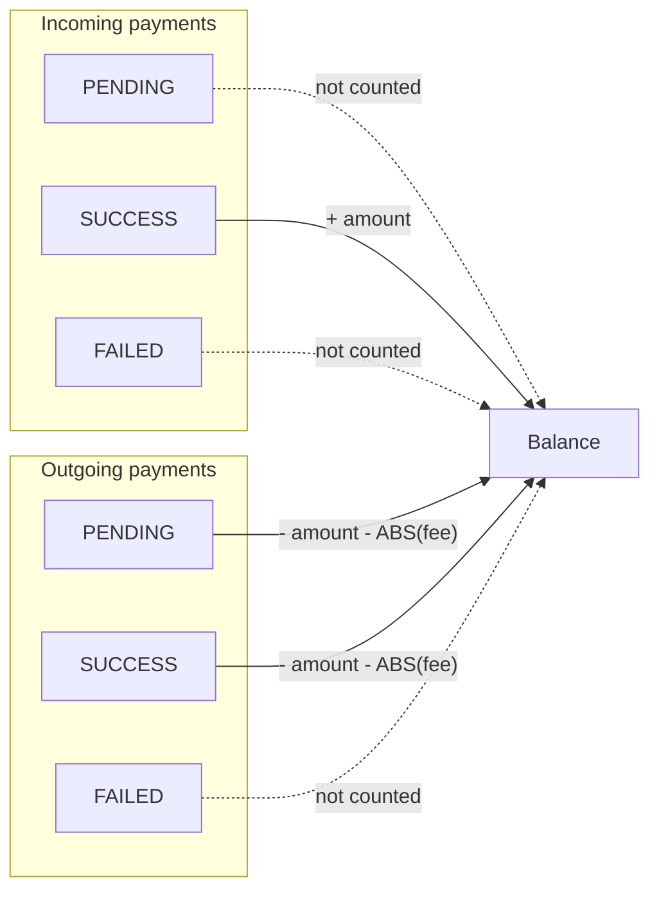
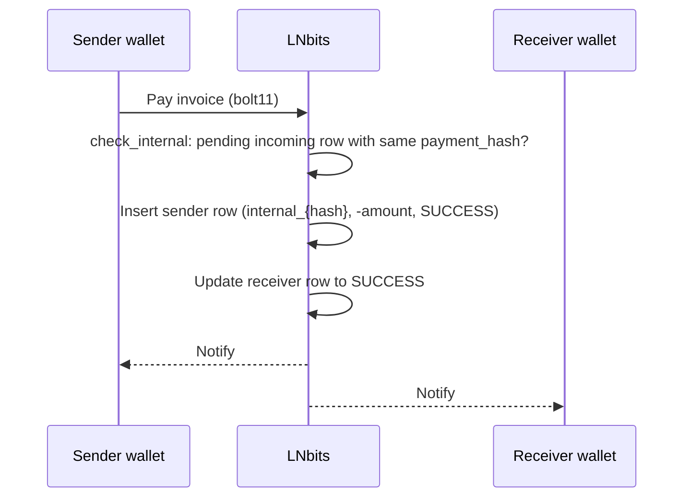
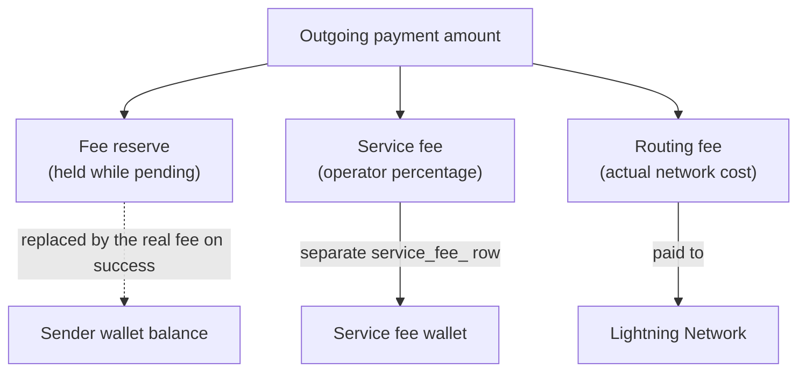
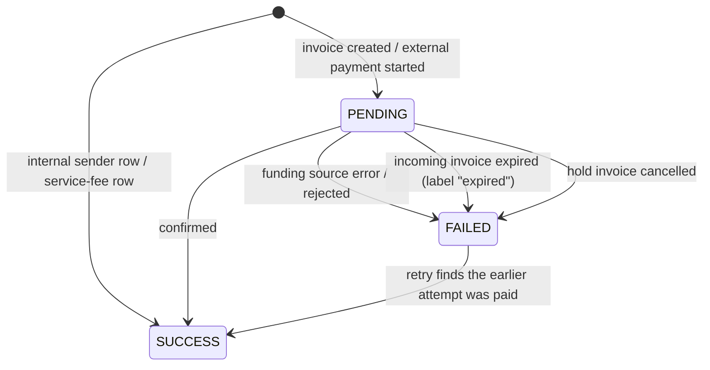
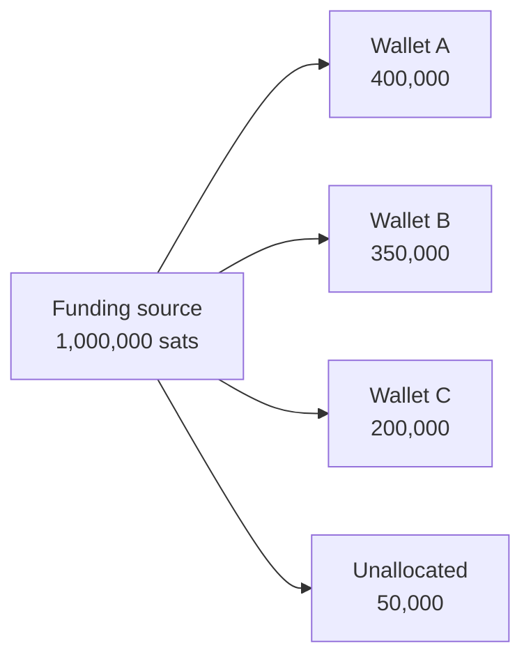

# Ledger System

LNbits uses a single-table ledger to track all wallet balances and payments. Understanding it helps when building extensions or debugging payment issues. Everything on this page describes LNbits v1.6.2 (`lnbits/core/migrations.py`, `lnbits/core/services/payments.py`).

## Design Philosophy {#design-philosophy}

LNbits uses a **simplified ledger** rather than double-entry bookkeeping:

- One `apipayments` table stores every payment
- Signed amounts (positive = incoming, negative = outgoing), in millisatoshis
- Balances are computed by the `balances` SQL view when read; they are not stored
- No separate debit/credit columns

## Database Schema {#database-schema}

### Payments Table {#payments-table}

The table was built up by many migrations (m001 onwards). Its columns in v1.6.2 are equivalent to:

```sql
-- Not a literal CREATE statement: the columns as they stand after all migrations.
apipayments (
    checking_id    TEXT NOT NULL,      -- id used to check status with the funding source
    payment_hash   TEXT,               -- BOLT11 payment hash (nullable: added by ALTER)
    wallet_id      TEXT NOT NULL,
    amount         BIGINT NOT NULL,    -- signed millisatoshis
    fee            INTEGER NOT NULL DEFAULT 0,  -- millisatoshis, sign not normalised
    bolt11         TEXT,
    preimage       TEXT,
    status         TEXT DEFAULT 'pending',      -- pending / success / failed
    memo           TEXT,
    time           TIMESTAMP NOT NULL,
    expiry         TIMESTAMP,
    webhook        TEXT,
    webhook_status TEXT,
    tag            TEXT,
    extension      TEXT,
    fiat_provider  TEXT,
    labels         TEXT,
    external_id    TEXT,
    created_at     TIMESTAMP,
    updated_at     TIMESTAMP,
    extra          TEXT,               -- JSON
    UNIQUE (wallet_id, checking_id)
)
```

There is no primary key column. The old boolean `pending` column was dropped in m024; `status` replaced it.

### Key Fields {#key-fields}

| Field | Type | Description |
|-------|------|-------------|
| `amount` | Signed int | Positive for incoming, negative for outgoing (msat) |
| `fee` | Int | Fee in msat. Usually negative on outgoing rows, but not always (see [Fee sign](#fee-sign)) |
| `status` | Text | `pending`, `success` or `failed` |
| `checking_id` | Text | Unique per wallet; used to look the payment up at the funding source |
| `expiry` | Timestamp | When an incoming invoice expires |
| `extra` | JSON | Extensible metadata |

## Balance Calculation {#balance-calculation}

Balances are computed by the `balances` view (migration `m025_refresh_view`):

```sql
CREATE VIEW balances AS
SELECT apipayments.wallet_id,
       SUM(apipayments.amount - ABS(apipayments.fee)) AS balance
FROM wallets
LEFT JOIN apipayments ON apipayments.wallet_id = wallets.id
WHERE (wallets.deleted = false OR wallets.deleted is NULL)
AND (
    (apipayments.status = 'success' AND apipayments.amount > 0)            -- incoming: only confirmed
    OR (apipayments.status IN ('success', 'pending') AND apipayments.amount < 0)  -- outgoing: immediately
)
GROUP BY apipayments.wallet_id
```

`get_wallet` reads it as `COALESCE((SELECT balance FROM balances ...), 0) AS balance_msat`. Deleted wallets are excluded.

### Balance Rules {#balance-rules}



| Direction | Status | Affects Balance? |
|-----------|--------|------------------|
| Incoming | PENDING | No (wait for confirmation) |
| Incoming | SUCCESS | Yes (add amount, minus any fee) |
| Incoming | FAILED | No |
| Outgoing | PENDING | Yes (immediate deduction, including the fee reserve) |
| Outgoing | SUCCESS | Yes (confirmed deduction) |
| Outgoing | FAILED | No (the funds are available again) |

**Why immediate deduction for outgoing?** It prevents double-spending: funds are reserved as soon as a payment starts. The other half of the protection is a per-wallet lock around the balance check and the insert (`wallets_payments_lock` in `services/payments.py`). That lock is an in-process `asyncio` lock, so LNbits must run as a single process.

## Internal Transfers {#internal-transfers}

When the sender and the receiver are on the same LNbits instance:



### Internal Payment Characteristics {#internal-payment-characteristics}

- The **sender** row gets `checking_id = internal_{payment_hash}`. The receiver row keeps its original `checking_id`.
- No routing fee and no fee reserve. A service fee is charged only if `LNBITS_SERVICE_FEE_IGNORE_INTERNAL=false`.
- Instant settlement, and no funding source call, so it works even with `VoidWallet`.
- The two rows are written by two separate statements, each committed on its own. They are not wrapped in one database transaction; the in-process locks keep the order.

### Ledger Entries for Internal Transfer {#ledger-entries-for-internal-transfer}

```
Receiver wallet: +10,000,000 msat (status: SUCCESS)
Sender wallet:   -10,000,000 msat (status: SUCCESS)
Net change:                0 msat (balanced)
```

## Fee Handling {#fee-handling}

### Fee Types {#fee-types}



The reserve and the service fee are charged **on top of** the amount, not taken out of it.

### Fee sign {#fee-sign}

The sign of `fee` is not normalised in storage. That is why the view uses `ABS(fee)`:

| Row | Stored `fee` |
|-----|--------------|
| External outgoing, pending | `-(reserve + service fee)` |
| External outgoing, success | `-(routing fee + service fee)` |
| Internal outgoing (sender) | `+service fee` (positive, usually 0) |
| Incoming | Whatever the funding source reports, usually 0 |

Don't rely on the sign of `fee`. Use its absolute value.

### Fee Configuration {#fee-configuration}

```bash
# Fee reserve (held during payment)
LNBITS_RESERVE_FEE_MIN=2000        # Minimum reserve (msat)
LNBITS_RESERVE_FEE_PERCENT=1.0     # Percentage reserve

# Service fee (operator revenue), off unless LNBITS_SERVICE_FEE_WALLET is set
LNBITS_SERVICE_FEE=0.5             # 0.5% of payment (default 0)
LNBITS_SERVICE_FEE_MAX=1000        # Max 1000 sats (default 0 = no cap)
LNBITS_SERVICE_FEE_WALLET=         # Collection wallet ID
LNBITS_SERVICE_FEE_IGNORE_INTERNAL=true
```

With the Admin UI on (the default), these live in the database after the first start and override `.env`. Change them in the Admin UI.

### Fee Accounting {#fee-accounting}

For a 10,000 sat outgoing payment with the settings above:

```
Payment amount:     -10,000,000 msat
Fee reserve (1%):      -100,000 msat   (beats the 2,000 msat minimum)
Service fee (0.5%):     -50,000 msat
─────────────────────────────────────
Pending row: amount -10,000,000, fee -150,000  → -10,150,000 counted

After routing (actual routing fee: 50,000 msat):
Success row: amount -10,000,000, fee -100,000  → -10,100,000 counted
Fee wallet:  service_fee_{hash}, +50,000 msat, SUCCESS
```

There is no refund row. The pending row's `fee` is overwritten with the real fee.

## Payment States {#payment-states}



While a row is pending, an outgoing row already reduces the balance and an incoming row does not.

### State Transitions {#state-transitions}

| From | To | Trigger | Balance Effect |
|------|----|---------|----------------|
| - | PENDING | Invoice created / external payment started | None (incoming) / Deduct (outgoing) |
| - | SUCCESS | Internal sender row, service-fee row | Deduct / Add |
| PENDING | SUCCESS | Payment confirmed | Add (incoming) / Keep deduction, fee adjusted (outgoing) |
| PENDING | FAILED | Error, rejection, expiry (incoming, label `expired`), hold-invoice cancel | None (incoming) / Funds released (outgoing) |
| FAILED | SUCCESS | Paying the same invoice again, when the funding source reports it was in fact paid | Deduct again (outgoing) |

`FAILED` is therefore not final. `SUCCESS` rows are also not frozen: labels, new `extra` keys and hold-invoice flags can still be written to them.

## Payment Identification {#payment-identification}

### Checking ID Formats {#checking-id-formats}

| Type | Format | Example |
|------|--------|---------|
| Incoming | The funding source's id | often the payment hash |
| External outgoing | `{payment_hash}`, possibly replaced by the funding source's id | `a1b2c3d4...` |
| Internal (sender row) | `internal_{payment_hash}` | `internal_a1b2c3...` |
| Service fee | `service_fee_{payment_hash}` | `service_fee_a1b2...` |
| Fiat provider | `fiat_{provider}_{id}` | `fiat_stripe_...` |

### Payment Hash {#payment-hash}

The 32-byte BOLT11 payment hash serves as:
- The matching key for internal transfers
- The lookup key for most API calls (`/api/v1/payments/{payment_hash}`)
- Proof of payment, together with the preimage

## Querying the Ledger {#querying-the-ledger}

### Get Wallet Balance {#get-wallet-balance}

```python
from lnbits.core.crud import get_wallet

wallet = await get_wallet(wallet_id)
wallet.balance_msat  # from the balances view
wallet.balance       # balance_msat // 1000 (sats)
```

### Payment History {#payment-history}

```python
from lnbits.core.crud import get_payments

payments = await get_payments(   # keyword-only arguments
    wallet_id=wallet_id,
    pending=True,      # include pending
    complete=True,     # include complete
    limit=100,
    offset=0,
)
```

### Daily Statistics {#daily-statistics}

```python
from lnbits.core.crud.payments import get_daily_stats

stats_in, stats_out = await get_daily_stats(filters, user_id=user_id)
# Each is a list of PaymentDailyStats:
# date, balance, balance_in, balance_out, payments_count, count_in, count_out, fee
```

`get_daily_stats(filters=None, user_id=None)` takes a `Filters[PaymentFilters]` (for example a `wallet_id` filter), not a `wallet_id` argument.

## Audit Trail {#audit-trail}

Every payment has:

| Field | Purpose |
|-------|---------|
| `created_at` | When the record was created |
| `updated_at` | Last modification time |
| `time` | Payment timestamp |
| `extra` | JSON metadata (extension data, fiat rates, etc.) |

LNbits keeps no history of status changes. The separate `audit` table logs HTTP requests (IP, user, path, response), not ledger changes.

Extensions can store custom data in `extra`:

```python
extra = {
    "tag": "tpos",
    "tpos_id": "abc123",
    "fiat_amount": 10.50,
    "fiat_currency": "USD",
}
```

## Balance Reconciliation {#balance-reconciliation}

The sum of all wallet balances should never exceed the funding source balance. LNbits monitors this but does not enforce it:



The tooling:

- **`GET /admin/api/v1/audit`** (admin) returns `lnbits_balance_sats` and `node_balance_sats`.
- **The watchdog** runs every `LNBITS_WATCHDOG_INTERVAL_MINUTES` (default 60). If LNbits' total exceeds the node balance by at least `LNBITS_WATCHDOG_DELTA` sats (default 1,000,000), it sends an admin notification and, with `LNBITS_WATCHDOG_SWITCH_TO_VOIDWALLET=true`, switches the funding source to `VoidWallet`. It does nothing unless `LNBITS_WATCHDOG_SWITCH_TO_VOIDWALLET` or `LNBITS_NOTIFICATION_WATCHDOG` is enabled; both default to off.

## See Also

- [Ledger Specification](/docs/architecture/ledger-spec): an independent lndocs proposal, not LNbits behaviour
- [Architecture Overview](/docs/architecture/overview)
- [Payments](/docs/architecture/payments)
- [API: Payments](/docs/api/payments)
