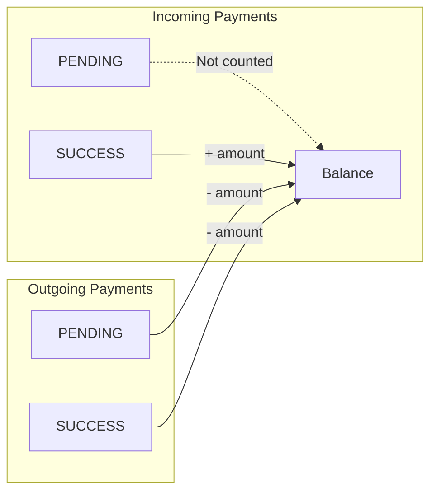
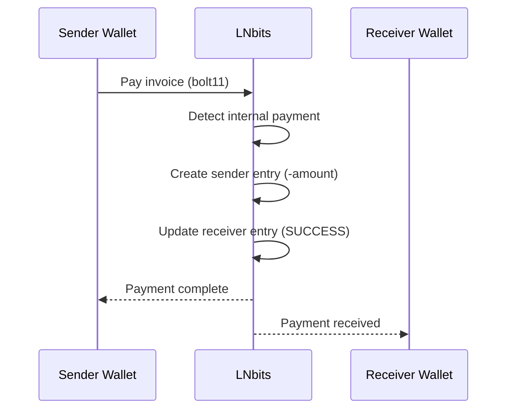
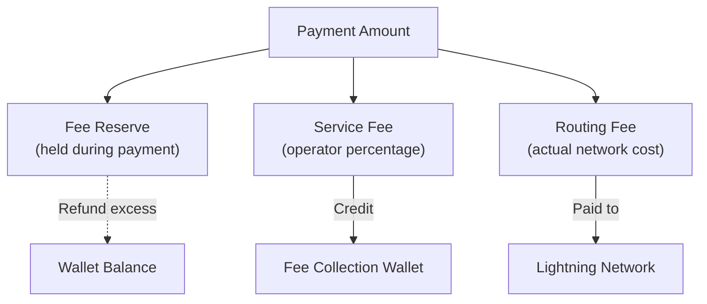
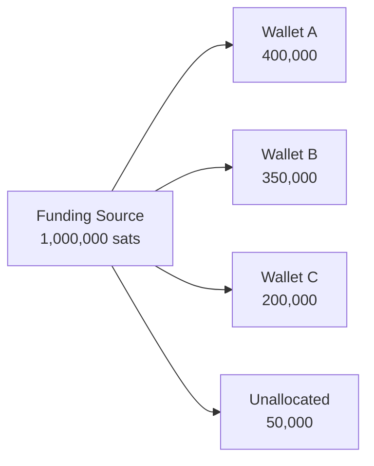

# Ledger System

LNbits uses a single-table ledger system to track all wallet balances and payments. Understanding this system helps when building extensions or debugging payment issues.

## Design Philosophy

LNbits uses a **simplified ledger** approach rather than traditional double-entry bookkeeping:

- Single `apipayments` table stores all transactions
- Signed amounts (positive = incoming, negative = outgoing)
- Balances calculated via SQL VIEW on read
- No separate debit/credit columns

This design prioritizes simplicity and performance for wallet-based payment systems.

## Database Schema

### Payments Table

```sql
CREATE TABLE apipayments (
    checking_id TEXT NOT NULL,      -- Unique payment identifier
    payment_hash TEXT NOT NULL,     -- BOLT11 payment hash
    wallet_id TEXT NOT NULL,        -- Associated wallet
    amount BIGINT NOT NULL,         -- Signed millisatoshis
    fee INTEGER NOT NULL DEFAULT 0, -- Fee (always negative)
    bolt11 TEXT,                    -- Invoice string
    preimage TEXT,                  -- Payment proof
    status TEXT DEFAULT 'pending',  -- pending/success/failed
    memo TEXT,                      -- Description
    time TIMESTAMP NOT NULL,
    created_at TIMESTAMP,
    updated_at TIMESTAMP,
    extra TEXT,                     -- JSON metadata
    UNIQUE (wallet_id, checking_id)
);
```

### Key Fields

| Field | Type | Description |
|-------|------|-------------|
| `amount` | Signed int | Positive for incoming, negative for outgoing (millisats) |
| `fee` | Negative int | Routing/service fees deducted |
| `status` | Enum | `pending`, `success`, or `failed` |
| `checking_id` | String | Primary identifier for tracking |
| `extra` | JSON | Extensible metadata field |

## Balance Calculation

Balances are computed dynamically via a SQL VIEW:

```sql
CREATE VIEW balances AS
SELECT wallet_id,
       SUM(amount - ABS(fee)) AS balance
FROM apipayments
WHERE (
    (status = 'success' AND amount > 0)      -- Incoming: only confirmed
    OR (status IN ('success', 'pending') AND amount < 0)  -- Outgoing: immediate
)
GROUP BY wallet_id;
```

### Balance Rules



| Direction | Status | Affects Balance? |
|-----------|--------|------------------|
| Incoming | PENDING | No (wait for confirmation) |
| Incoming | SUCCESS | Yes (add to balance) |
| Outgoing | PENDING | Yes (immediate deduction) |
| Outgoing | SUCCESS | Yes (confirmed deduction) |

**Why immediate deduction for outgoing?** Prevents double-spending. When you initiate a payment, funds are reserved immediately.

## Internal Transfers

When both sender and receiver are on the same LNbits instance:



### Internal Payment Characteristics

- `checking_id` format: `internal_{payment_hash}`
- Zero routing fees
- Instant settlement
- Works without funding source connectivity

### Ledger Entries for Internal Transfer

```
Receiver wallet: +10,000 msat (status: SUCCESS)
Sender wallet:   -10,000 msat (status: SUCCESS)
Net change:           0 msat (balanced)
```

## Fee Handling

### Fee Types



### Fee Configuration

```bash
# Fee reserve (held during payment, excess refunded)
LNBITS_RESERVE_FEE_MIN=2000        # Minimum reserve (msats)
LNBITS_RESERVE_FEE_PERCENT=1.0     # Percentage reserve

# Service fee (operator revenue)
LNBITS_SERVICE_FEE=0.5             # 0.5% of payment
LNBITS_SERVICE_FEE_MAX=1000        # Max 1000 sats
LNBITS_SERVICE_FEE_WALLET=...      # Collection wallet ID
```

### Fee Accounting

For a 10,000 sat outgoing payment:

```
Payment amount:     -10,000,000 msat
Fee reserve:           -100,000 msat (1%)
Service fee (0.5%):     -50,000 msat
─────────────────────────────────────
Total reserved:     -10,150,000 msat

After routing (actual fee: 50,000 msat):
Refund:                +50,000 msat (reserve - actual)
Final deduction:    -10,100,000 msat
```

## Payment States

```mermaid
stateDiagram-v2
    [*] --> PENDING: Invoice created / Payment initiated

    PENDING --> SUCCESS: Confirmed
    PENDING --> FAILED: Expired / Rejected / Error

    SUCCESS --> [*]: Final
    FAILED --> [*]: Final

    note right of PENDING: Outgoing: balance deducted\nIncoming: balance unchanged
    note right of SUCCESS: Both directions: balance reflects payment
```

### State Transitions

| From | To | Trigger | Balance Effect |
|------|----|---------|----------------|
| - | PENDING | Invoice created | None (incoming) / Deduct (outgoing) |
| PENDING | SUCCESS | Payment confirmed | Add (incoming) / Keep deduction (outgoing) |
| PENDING | FAILED | Timeout/error | None (incoming) / Refund (outgoing) |

## Payment Identification

### Checking ID Formats

| Type | Format | Example |
|------|--------|---------|
| External | `{payment_hash}` | `a1b2c3d4...` |
| Internal | `internal_{payment_hash}` | `internal_a1b2c3...` |
| Service fee | `service_fee_{payment_hash}` | `service_fee_a1b2...` |

### Payment Hash

The 32-byte BOLT11 payment hash serves as:
- Unique identifier across Lightning Network
- Matching key for internal transfers
- Proof verification (via preimage)

## Querying the Ledger

### Get Wallet Balance

```python
# Fetches balance from the balances VIEW
wallet = await get_wallet(wallet_id)
balance_sats = wallet.balance  # Computed property
```

### Payment History

```python
# Get all payments for a wallet
payments = await get_payments(
    wallet_id=wallet_id,
    pending=True,      # Include pending
    complete=True,     # Include complete
    limit=100,
    offset=0
)
```

### Daily Statistics

```python
# Aggregate by day
stats_in, stats_out = await get_daily_stats(
    wallet_id=wallet_id
)
# Returns: date, balance, fee, payments_count
```

## Audit Trail

Every payment includes:

| Field | Purpose |
|-------|---------|
| `created_at` | When record was created |
| `updated_at` | Last modification time |
| `time` | Payment timestamp |
| `extra` | JSON metadata (extension data, etc.) |

Extensions can store custom data in the `extra` field:

```python
extra = {
    "tag": "tpos",
    "tpos_id": "abc123",
    "fiat_amount": 10.50,
    "fiat_currency": "USD"
}
```

## Balance Reconciliation

The sum of all wallet balances should never exceed the funding source balance:



**Monitor for discrepancies:**
- Total wallet balances > funding source = **problem**
- Regular reconciliation recommended for production

## See Also

- [Architecture Overview](/docs/architecture/overview)
- [Payments](/docs/architecture/payments)
- [API: Payments](/docs/api/payments)
