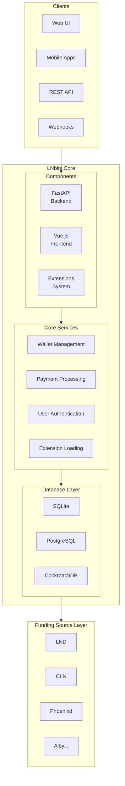
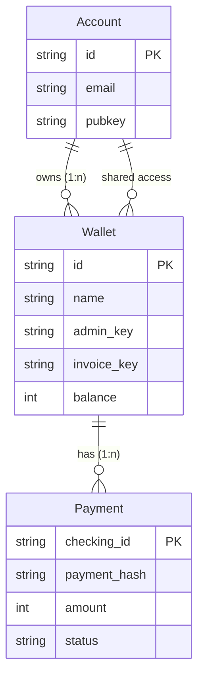
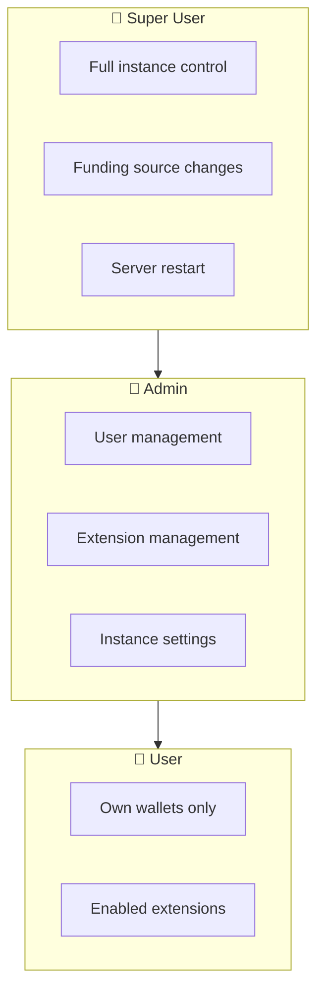

# Architecture Overview

LNbits is a modular Lightning Network accounts system built with modern Python and web technologies.

## High-Level Architecture



## Technology Stack

| Layer | Technology | Purpose |
|-------|------------|---------|
| HTTP Server | Uvicorn | ASGI server |
| Web Framework | FastAPI | REST API, routing |
| ORM | SQLAlchemy | Database abstraction |
| Frontend | Vue.js + Quasar | User interface |
| Task Queue | asyncio | Background tasks |
| Caching | In-memory | Exchange rates, sessions |

## Core Components

### 1. FastAPI Backend

The backend is built with FastAPI, providing:

- **REST API**: CRUD operations for wallets, payments, users
- **Authentication**: API keys, OAuth2, Nostr NIP-98
- **Middleware**: Rate limiting, CORS, session handling
- **WebSockets**: Real-time payment notifications

```python
# Example route structure
lnbits/core/views/
├── auth_api.py        # Authentication endpoints
├── payment_api.py     # Payment operations
├── wallet_api.py      # Wallet management
├── user_api.py        # User profiles
├── admin_api.py       # Admin operations
└── extension_api.py   # Extension management
```

### 2. Database Layer

LNbits supports multiple databases:

- **SQLite**: Default, single-file database
- **PostgreSQL**: Recommended for production
- **CockroachDB**: Distributed database

Core tables:
- `accounts`: User accounts
- `wallets`: Wallet metadata and API keys
- `apipayments`: Transaction history
- `extensions`: Per-user extension settings

### 3. Funding Source Abstraction

The `Wallet` base class defines the interface:

```python
class Wallet:
    async def status() -> StatusResponse
    async def create_invoice() -> InvoiceResponse
    async def pay_invoice() -> PaymentResponse
    async def get_invoice_status() -> PaymentStatus
    async def get_payment_status() -> PaymentStatus
```

Implementations exist for 24+ backends.

### 4. Extension System

Extensions are self-contained modules:

```
extension/
├── manifest.json     # Metadata
├── views.py          # UI routes
├── views_api.py      # API routes
├── migrations.py     # Database schema
├── models.py         # Data models
├── crud.py           # Database operations
└── templates/        # HTML templates
```

## Request Flow

### Creating an Invoice

```
1. Client → POST /api/v1/payments
2. FastAPI validates request + auth
3. Core service checks wallet balance limits
4. Funding source creates Lightning invoice
5. Payment record stored in database
6. Response returned to client
7. (Optional) Webhook notification scheduled
```

### Paying an Invoice

```
1. Client → POST /api/v1/payments (with bolt11)
2. FastAPI validates request + admin key
3. Core service checks wallet balance
4. Internal payment check (same instance?)
   ├── Yes: Instant internal transfer
   └── No: Forward to funding source
5. Payment record updated
6. Balance recalculated
7. Response returned to client
```

## Data Models

### Core Entities



### Wallet Types

- **LIGHTNING**: Standard individual wallet
- **LIGHTNING_SHARED**: Shared between users

### Payment States

- **PENDING**: Awaiting confirmation
- **SUCCESS**: Confirmed
- **FAILED**: Rejected or expired

## Security Architecture

### Authentication Layers

1. **API Keys**: Per-wallet admin/invoice keys
2. **Session Tokens**: JWT for web UI
3. **OAuth2**: External identity providers
4. **Nostr**: NIP-98 event signing

### Authorization Model



## Performance Characteristics

- **Async I/O**: Non-blocking operations
- **Connection Pooling**: SQLAlchemy async pools
- **Rate Limiting**: Configurable per-IP limits
- **GZip Compression**: Response compression

## Scalability Considerations

### Single Instance
- SQLite sufficient for small deployments
- All processing in single process

### Production Scale
- PostgreSQL with connection pooling
- Multiple workers via Uvicorn
- Reverse proxy (Nginx/Caddy) for SSL
- External Redis for session storage (optional)

## See Also

- [Wallets Architecture](/docs/architecture/wallets)
- [Payments Architecture](/docs/architecture/payments)
- [Funding Sources](/docs/architecture/funding-sources)
