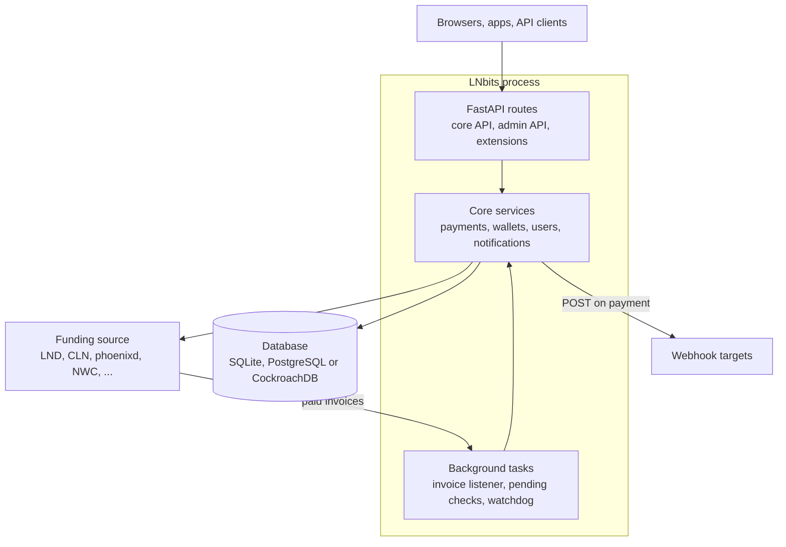
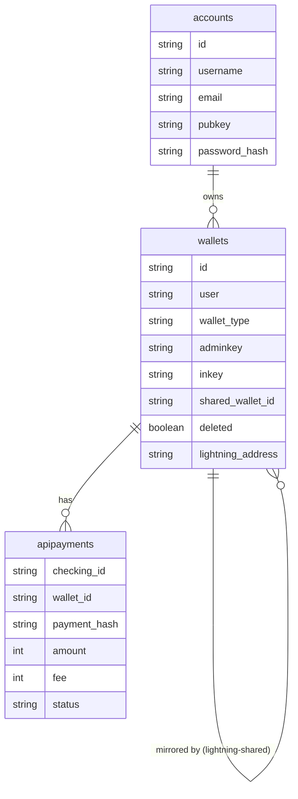
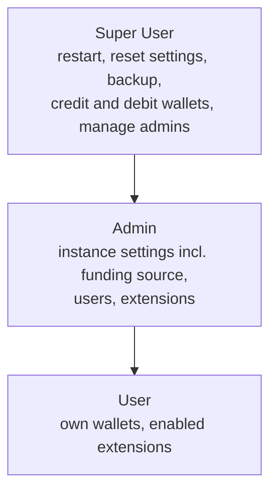

# Architecture Overview

LNbits is a single Python process that keeps Lightning accounts for many users on top of one funding source. It serves a REST API and a web UI, records every payment in its own database, and calls the funding source to create and pay invoices.

## High-level architecture {#high-level-architecture}

The core services talk to both the database and the funding source. The database never talks to the funding source. Webhooks are outbound: LNbits POSTs to them when an invoice is paid. Backends that push events to LNbits use the callback routes in `lnbits/core/views/callback_api.py`.

## Technology stack {#technology-stack}

| Layer | Technology |
|---|---|
| HTTP server | Uvicorn (one process, started by the `lnbits` command) |
| Web framework | FastAPI |
| Database access | SQLAlchemy async engine with hand-written SQL (no ORM models) |
| Frontend | Vue 3 and Quasar |
| Background work | asyncio tasks inside the same process |
| Caching | In-memory only |

## Core components {#core-components}

### HTTP layer {#fastapi-backend}

The core routes live in `lnbits/core/views/`. The main files are `payment_api.py`, `wallet_api.py`, `auth_api.py`, `user_api.py` (user management, under `/users/api/v1`), `admin_api.py` (under `/admin/api/v1`), `extension_api.py`, `lnurl_api.py`, `websocket_api.py`, `fiat_api.py`, `node_api.py` and `callback_api.py`.

Middleware adds:

- per-IP rate limiting (slowapi; `LNBITS_RATE_LIMIT_NO` per `LNBITS_RATE_LIMIT_UNIT`);
- IP allow and block lists (`LNBITS_ALLOWED_IPS`, `LNBITS_BLOCKED_IPS`);
- GZip compression;
- CORS with `allow_origins=["*"]`. Any website can call the API from a browser, so protect keys rather than relying on the origin.

### Database layer {#database-layer}

LNbits supports SQLite (the default), PostgreSQL and CockroachDB, chosen by `LNBITS_DATABASE_URL`. On SQLite the core database is `database.sqlite3` in the data folder, and each extension gets its own `ext_<id>.sqlite3`.

The main core tables are:

| Table | Holds |
|---|---|
| `accounts` | Users |
| `wallets` | Wallets and their API keys |
| `apipayments` | Every payment, incoming and outgoing |
| `balances` | A **view**, not a table: wallet balances computed from `apipayments` |
| `extensions` | Which extensions each user has enabled |
| `installed_extensions` | Extensions installed on the instance |
| `system_settings` | The Super User ID and the settings edited in the Admin UI |
| `audit` | HTTP request audit log |
| `assets`, `tiny_url`, `webpush_subscriptions` | Uploaded files, short URLs, push subscriptions |
| `wasm_invocations` | WASM extension call records (v1.6.0) |
| `dbversions` | Migration versions |

Wallet balances are never stored. See [Ledger](/docs/architecture/ledger).

Each `Database` object holds an `asyncio.Lock` for as long as a connection is open, so database access is serialised within the process. There is no connection pool to tune.

### Funding source {#funding-source-abstraction}

All backends implement the abstract `Wallet` class in `lnbits/wallets/base.py`: `status`, `create_invoice`, `pay_invoice`, `get_invoice_status`, `get_payment_status` and `cleanup`, plus optional hold-invoice methods and a `paid_invoices_stream`. v1.6.2 ships 25 backend classes, including `FakeWallet` and the default `VoidWallet`. See [Funding Sources](/docs/architecture/funding-sources).

### Extensions {#extension-system}

There are two kinds of extension:

- **Python extensions** are Python packages loaded into the LNbits process. Each has a `config.json` with its metadata, and usually `views.py`, `views_api.py`, `migrations.py`, `models.py`, `crud.py` and templates. Downloaded releases are kept in `upgrades/` in the data folder, and the active code is loaded from `extensions/` under `LNBITS_EXTENSIONS_PATH`. They run with full access to the process and the database: they are **not sandboxed**.
- **WASM extensions** (new in v1.6.0) are WebAssembly modules run by `wasmtime` with fuel, memory and time limits. Their UI runs in a sandboxed iframe, and they reach LNbits only through host functions that the admin grants at install time. They live in `wasm_extensions/` in the data folder.

:::warning
Installing a Python extension is like installing any other server software: it can read every wallet key and move funds. Only install extensions you trust.
:::

See [Extensions](/docs/extensions/overview).

## Request flow {#request-flow}

### Creating an invoice {#creating-an-invoice}

1. The client calls `POST /api/v1/payments` with `"out": false`, using the wallet's invoice or admin key.
2. LNbits checks that the wallet may receive, that the amount is within `LNBITS_MAX_INCOMING_PAYMENT_AMOUNT_SATS`, and that the wallet won't go over `LNBITS_WALLET_LIMIT_MAX_BALANCE`.
3. The funding source creates the invoice.
4. LNbits stores a **pending** row in `apipayments` and returns the payment.
5. When the funding source reports the invoice paid, the invoice listener marks the row successful and sends notifications, including the webhook if one was set.

### Paying an invoice {#paying-an-invoice}

1. The client calls `POST /api/v1/payments` with a `bolt11`, using the **admin key**. If `out` is left out, it defaults to paying.
2. LNbits takes a global payment lock and a per-wallet lock, then checks the balance, including the fee reserve.
3. If the invoice belongs to another wallet on the same instance, LNbits settles it internally: no Lightning payment is made.
4. Otherwise it stores a pending row and asks the funding source to pay. It waits up to `LNBITS_FUNDING_SOURCE_PAY_INVOICE_WAIT_SECONDS` (default 5); if there's no answer yet, the payment stays pending and is checked again later.
5. On success, the row is updated with the real fee and marked successful.

See [Payments](/docs/architecture/payments) and [Ledger](/docs/architecture/ledger).

## Data model {#data-models}

- `apipayments` has no primary key. Rows are unique on `(wallet_id, checking_id)`. `amount` is signed, in msat: positive for incoming, negative for outgoing.
- A shared wallet is a second `wallets` row of type `lightning-shared` whose `shared_wallet_id` points at the source wallet. See [Wallets](/docs/architecture/wallets).
- The balance is not a column. It comes from the `balances` view.

### Wallet types {#wallet-types}

`lightning` (an ordinary wallet) and `lightning-shared` (a mirror of another user's wallet).

### Payment states {#payment-states}

`pending`, `success` and `failed`. These are not strictly one-way: a failed outgoing payment is set to success if the backend later reports it paid. See [Ledger](/docs/architecture/ledger).

## Security architecture {#security-architecture}

### How requests are authenticated {#authentication-layers}

| Credential | Used for |
|---|---|
| Wallet admin key or invoice key (`X-Api-Key` header or `api-key` query) | Wallet routes only |
| Login JWT (bearer token or `cookie_access_token` cookie) | User, admin and wallet-management routes |
| ACL API tokens (bearer) | Scripted access to user routes, limited per path |
| `?usr=` user ID | Only when `user-id-only` login is enabled (off by default since v1.6.0), and never for admins |

Login methods (username and password, Nostr NIP-98, Google, GitHub, Keycloak, OIDC) are described in [Users & Accounts](/docs/architecture/users).

### Roles {#authorization-model}

Each role includes the powers of the ones below it. Admins and the Super User must have a password set.

## Running LNbits: one process only {#scalability-considerations}

:::danger Run a single LNbits process per database
LNbits protects against double spends with **in-process asyncio locks**: a global payment lock, a lock per wallet, and a lock per database connection. These locks don't work across processes. If you run several LNbits processes or containers against the same database, two of them can pay from the same wallet at the same time and overdraw it.

The `lnbits` command has no workers option. Don't put several LNbits instances behind a load balancer, and don't run more than one replica in Docker or Kubernetes.
:::

What does help:

- **PostgreSQL** instead of SQLite for larger instances. See [Database](/docs/configuration/database).
- A **reverse proxy** (Caddy or nginx) for TLS. See [Reverse Proxy](/docs/deployment/reverse-proxy).

There is no Redis or other external cache. All caching is in memory.

## See also {#see-also}

- [Wallets](/docs/architecture/wallets)
- [Payments](/docs/architecture/payments)
- [Funding Sources](/docs/architecture/funding-sources)
- [Ledger](/docs/architecture/ledger)
