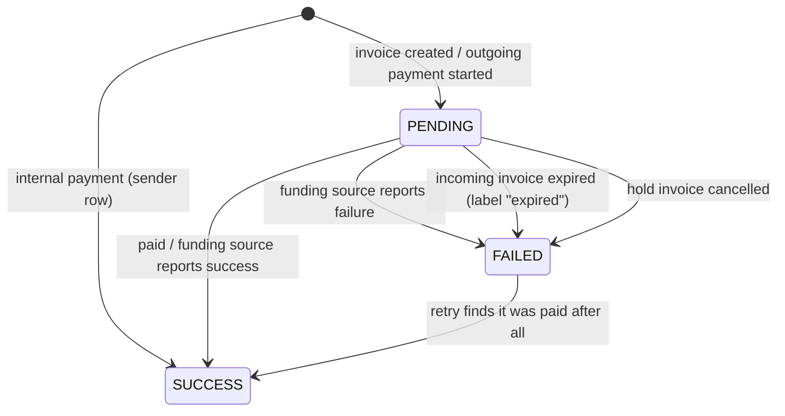

# Payments Architecture

Every incoming invoice and outgoing payment in LNbits is one row in the `apipayments` table. This page describes how those rows are created and updated in LNbits v1.6.2. For how they add up to a balance, see [Ledger System](/docs/architecture/ledger).

## Payment Model {#payment-model}

The `Payment` model (`lnbits/core/models/payments.py`) has these fields:

```python
class Payment(BaseModel):
    checking_id: str             # identifier used to check status with the funding source
    payment_hash: str            # BOLT11 payment hash
    wallet_id: str
    amount: int                  # millisatoshis, signed: > 0 incoming, < 0 outgoing
    fee: int                     # millisatoshis; sign is not normalised (see Fee Handling)
    bolt11: str
    payment_request: str | None  # not stored; bolt11, or the fiat provider's payment request
    fiat_provider: str | None
    status: str                  # "pending" | "success" | "failed"
    memo: str | None
    expiry: datetime | None
    webhook: str | None
    webhook_status: str | None   # HTTP status code of the webhook call, or "-1"
    preimage: str | None
    tag: str | None              # extension tag
    extension: str | None
    time: datetime
    created_at: datetime
    updated_at: datetime
    labels: list[str]
    extra: dict
    external_id: str | None
```

## Payment Types {#payment-types}

Direction comes from the sign of `amount`. The model has `is_in` (`amount > 0`) and `is_out` (`amount < 0`) properties. There is no stored direction flag.

### Incoming Payments (Invoices) {#incoming-payments-invoices}

When you create an invoice, the row is stored with a positive `amount` and status `pending`.

### Outgoing Payments {#outgoing-payments}

When you pay an invoice, the row is stored with a negative `amount`.

:::caution `out` defaults to paying
`out` is a field of the **request** (`CreateInvoice`), not of the stored payment, and it **defaults to `true`**. A `POST /api/v1/payments` without `"out": false` is treated as a payment attempt: with an admin key and a `bolt11` it pays, and with an invoice key it is refused with 403. Always send `"out": false` to create an invoice.
:::

## Payment States {#payment-states}

`PaymentState` has three values: `pending`, `success` and `failed`. The transitions are not strictly one-way:



### State Transitions {#state-transitions}

| From | To | Trigger |
|------|----|---------|
| (new) | PENDING | Invoice created, or external payment started |
| (new) | SUCCESS | Sender row of an internal payment; service-fee row |
| PENDING | SUCCESS | Invoice paid, or the funding source confirms an outgoing payment |
| PENDING | FAILED | The funding source reports failure; an incoming invoice has expired (the `expired` label is added); a hold invoice is cancelled |
| FAILED | SUCCESS | Paying the same invoice again, when the funding source now reports the earlier attempt as paid (`_verify_external_payment`) |

A `success` row can still be edited later:

- its labels, with `PUT /api/v1/payments/{payment_hash}/labels`;
- new keys in its `extra`, with `PATCH /api/v1/payments/extra` (admin key; allowed only after success, and only for keys not already present);
- its hold-invoice flags.

## Payment Flow {#payment-flow}

### Creating an Invoice {#creating-an-invoice}

`POST /api/v1/payments` with `"out": false` (an invoice key is enough) calls `create_invoice` in `lnbits/core/services/payments.py`:

1. Reject amountless invoices, and wallets that can't receive (for example a shared wallet without the receive permission).
2. Convert a fiat `unit` to sats and record the rates in `extra`.
3. Check `LNBITS_MAX_INCOMING_PAYMENT_AMOUNT_SATS` and the maximum wallet balance (`LNBITS_WALLET_LIMIT_MAX_BALANCE`, 0 = no limit).
4. Ask the funding source for an invoice. The funding source is called with the amount in **sats**.
5. Store the row as `pending`, with the funding source's `checking_id`.
6. Return the `Payment` as JSON (`bolt11`, `payment_hash`, `checking_id`, …). No QR code is returned; the UI draws it.

A webhook, if given, is called only when the invoice is paid, not when it is created.

### Paying an Invoice {#paying-an-invoice}

`POST /api/v1/payments` with `"out": true` and `bolt11` (admin key required) calls `pay_invoice`:

1. Decode the BOLT11. Amountless invoices are refused, and the amount must not exceed `LNBITS_MAX_OUTGOING_PAYMENT_AMOUNT_SATS`.
2. Take the global `payment_lock`, then a per-wallet lock, and re-read the wallet balance.
3. Check for an internal payment (below). If it is one, settle it in the database.
4. Otherwise check the balance against the amount plus the fee reserve, create a `pending` row, and call the funding source.
5. Wait up to `LNBITS_FUNDING_SOURCE_PAY_INVOICE_WAIT_SECONDS` (default 5). If the funding source hasn't answered, return the payment still `pending`; it is resolved later.
6. On success, set `fee` to the actual routing fee plus the service fee. On failure, mark the row `failed`.

`pay_invoice` never sets a webhook, so a `webhook` field is ignored for outgoing payments in v1.6.2.

:::note Single process only
The locks in step 2 are in-process `asyncio` locks. They are what stops two concurrent payments from overspending one wallet, so LNbits must run as a single process. Don't run several LNbits processes against one database.
:::

## Internal Payments {#internal-payments}

When the invoice was issued by the same LNbits instance:

1. `check_internal` looks for a **pending incoming** row with the same `payment_hash`.
2. The amount and the `bolt11` must match that row, or the payment fails with "Invalid invoice. Bolt11 changed."
3. The sender's row is inserted with `checking_id = internal_{payment_hash}` and status `success`.
4. The receiver's row keeps its original `checking_id` and is updated to `success`.
5. Both wallets are notified.

The fee reserve for internal payments is 0. The service fee is also skipped, unless `LNBITS_SERVICE_FEE_IGNORE_INTERNAL` is set to `false`. No funding source call is made, so internal payments work even with `VoidWallet`.

## Fee Handling {#fee-handling}

### Routing Fees {#routing-fees}

`amount` always stays the (negative) invoice amount. Fees go in the separate `fee` column:

- While an external payment is pending, `fee = -(reserve + service fee)`.
- When it succeeds, `fee = -(routing fee + service fee)`, using the routing fee the funding source reports.

The fee sign is not normalised across all rows. For example, the sender row of an internal payment stores a positive (or zero) fee. The balance view uses `ABS(fee)` for this reason.

### Fee Reserve {#fee-reserve}

Before an external payment, LNbits checks that the wallet can cover the amount plus a reserve:

```bash
LNBITS_RESERVE_FEE_MIN=2000        # millisatoshis (default 2000 msat = 2 sat)
LNBITS_RESERVE_FEE_PERCENT=1.0     # percent of the amount (default 1.0)
```

The reserve is `max(LNBITS_RESERVE_FEE_MIN, amount × LNBITS_RESERVE_FEE_PERCENT / 100)` and is passed to the funding source as the routing fee limit. There is no separate refund row: the pending row's `fee` is overwritten with the real fee on success.

### Service Fees {#service-fees}

An optional operator fee, charged to the **sender** of outgoing payments on top of the amount:

```bash
LNBITS_SERVICE_FEE=0.5                    # percent (default 0 = off)
LNBITS_SERVICE_FEE_MAX=1000               # cap in sats (default 0 = no cap)
LNBITS_SERVICE_FEE_WALLET=                # wallet ID that collects fees (default empty = off)
LNBITS_SERVICE_FEE_IGNORE_INTERNAL=true   # default true: no fee on internal payments
```

No service fee is charged unless `LNBITS_SERVICE_FEE_WALLET` is set. The fee wallet gets its own `success` row with `checking_id = service_fee_{payment_hash}`. See [Service Fees](/docs/guides/service-fees).

With the Admin UI on (the default), these settings live in the database after the first start and override `.env`. Change them in the Admin UI (`/admin`).

## Payment Identification {#payment-identification}

### Checking ID {#checking-id}

| Row | `checking_id` |
|-----|---------------|
| Incoming invoice | The id the funding source returns (often the payment hash, but backend-specific) |
| External outgoing payment | Starts as the payment hash; the funding source may replace it with its own id |
| Internal payment, sender row | `internal_{payment_hash}` |
| Internal payment, receiver row | Unchanged (the incoming invoice's id) |
| Service fee | `service_fee_{payment_hash}` |
| Fiat provider invoice | `fiat_{provider}_{provider_checking_id}` |

Uniqueness is enforced on `(wallet_id, checking_id)`. There is no primary key column.

### Payment Hash {#payment-hash}

The BOLT11 payment hash (32 bytes, hex). It matches internal payments to their invoice, and `sha256(preimage) == payment_hash` proves payment.

## Webhooks {#webhooks}

Set a webhook when creating an invoice:

```bash
curl -X POST https://your-lnbits.example/api/v1/payments \
  -H "X-Api-Key: <invoice key>" \
  -H "Content-Type: application/json" \
  -d '{"out": false, "amount": 1000, "memo": "Test", "webhook": "https://your-server.example/callback"}'
```

When the invoice is paid, LNbits sends one `POST` to the webhook URL:

- The body is the whole `Payment` model, sent as `json=payment.json()`. `payment.json()` is already a JSON string, and httpx JSON-encodes it again, so the body is a **JSON string** you must decode twice.
- `amount` and `fee` are in **millisatoshis** (a 1000 sat invoice has `"amount": 1000000`), and `status` is `"success"`.
- It is sent once. The response status (or `-1` on error) is stored in `webhook_status`, and there is no retry.
- Webhook targets that resolve to private or non-global IPs (LAN, localhost) are refused unless `LNBITS_CALLBACK_ALLOW_PRIVATE_IPS=true`. Redirects are not followed.

## Hold Invoices {#hold-invoices}

Hold invoices need a funding source that supports them (`Feature.holdinvoice`). Otherwise creation fails with "Hold invoices are not supported by the funding source."

1. **Create:** `POST /api/v1/payments` with `"out": false` and `payment_hash` set to the SHA-256 of a preimage you generated (64 hex chars).
2. **Settle:** `POST /api/v1/payments/settle` with `{"preimage": "<64 hex>"}` (admin key).
3. **Cancel:** `POST /api/v1/payments/cancel` with `{"payment_hash": "<64 hex>"}` (admin key). This marks the payment `failed`.

Settling stores the preimage and sets `extra.hold_invoice_settled`; cancelling sets `extra.hold_invoice_cancelled`.

## Payment Extras {#payment-extras}

`extra` is a JSON object for extension and application data. When an invoice is created in a fiat `unit`, LNbits adds `fiat_currency`, `fiat_amount`, `fiat_rate` and `btc_rate`. When the wallet has a currency, it also adds `wallet_fiat_currency`, `wallet_fiat_amount`, `wallet_fiat_rate` and `wallet_btc_rate`.

```json
{
  "tag": "tpos",
  "fiat_currency": "USD",
  "fiat_amount": 10.5,
  "fiat_rate": 952.38,
  "btc_rate": 105000.0
}
```

## Payment Queries {#payment-queries}

`GET /api/v1/payments` (invoice key) returns the wallet's pending **and** completed payments, newest first. It takes the generic filter syntax `field[op]=value`, with operators `eq`, `ne`, `gt`, `ge`, `lt`, `le`, `in`, `ex`, `like`, `every` and `any`.

### By Status {#by-status}

```bash
GET /api/v1/payments?status=success
GET /api/v1/payments?status=pending
```

There is no `pending=true` filter; it is ignored.

### By Date Range {#by-date-range}

```bash
GET /api/v1/payments?time[ge]=2026-01-01T00:00:00&time[le]=2026-02-01T00:00:00
```

`since` and `until` are not filter fields and are ignored.

### Pagination {#pagination}

```bash
GET /api/v1/payments?limit=10&offset=20
GET /api/v1/payments/paginated?limit=50&offset=0   # returns {data, total}
```

The default limit is 10 and the maximum is 1000.

## Performance Considerations {#performance-considerations}

### Indexing {#indexing}

Migration `m039_index_payments` indexes `wallet_id`, `checking_id`, `payment_hash`, `amount`, `fee`, `labels`, `time`, `status`, `memo`, `created_at` and `updated_at` on `apipayments`.

### Background Tasks {#background-tasks}

`check_pending_payments` runs at startup and then every `LNBITS_FUNDING_SOURCE_PENDING_INTERVAL_SECONDS` (default 1800). It re-checks pending payments from the last 15 days with the funding source (it is skipped for `VoidWallet`), and marks expired incoming invoices `failed` with the label `expired`. Incoming payments are normally settled straight away by the funding source's paid-invoice stream.

## See Also

- [Ledger System](/docs/architecture/ledger)
- [Architecture Overview](/docs/architecture/overview)
- [Wallets](/docs/architecture/wallets)
- [API: Payments](/docs/api/payments)
