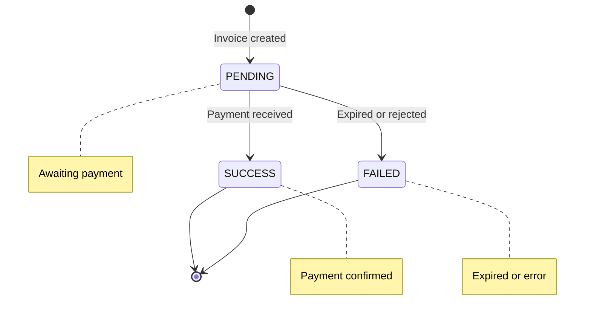

# Payments Architecture

The payment system handles all Lightning Network transactions in LNbits.

## Payment Model

```python
class Payment:
    checking_id: str      # Unique payment identifier
    payment_hash: str     # BOLT11 payment hash
    wallet_id: str        # Associated wallet
    amount: int           # Amount in millisatoshis
    fee: int              # Routing fee
    bolt11: str           # BOLT11 invoice string
    status: PaymentState  # PENDING, SUCCESS, FAILED
    memo: str             # Payment description
    preimage: str         # Payment preimage (proof)
    webhook: str          # Notification URL
    labels: List[str]     # Custom labels
    extra: dict           # Additional metadata
    created_at: datetime
    updated_at: datetime
```

## Payment Types

### Incoming Payments (Invoices)

```python
amount > 0  # Positive amount
out = False # Direction flag
```

When you receive sats, the amount is positive.

### Outgoing Payments

```python
amount < 0  # Negative amount
out = True  # Direction flag
```

When you send sats, the amount is stored as negative.

## Payment States



### State Transitions

| From | To | Trigger |
|------|----|---------|
| PENDING | SUCCESS | Payment received |
| PENDING | FAILED | Expiry or explicit failure |
| SUCCESS | - | Final state |
| FAILED | - | Final state |

## Payment Flow

### Creating an Invoice

```
1. Validate request
   └── Amount, memo, expiry

2. Check wallet limits
   └── Rate limits, max invoice

3. Generate via funding source
   └── LND, CLN, etc. creates BOLT11

4. Store in database
   └── Payment record with PENDING status

5. Return invoice
   └── BOLT11 string + QR code
```

### Paying an Invoice

```
1. Validate request
   └── Admin key required

2. Parse BOLT11
   └── Extract amount, hash, destination

3. Check wallet balance
   └── Sufficient funds + fee reserve

4. Check internal payment
   │
   ├── Internal: Direct balance transfer
   │   └── Instant, no routing fee
   │
   └── External: Route via funding source
       └── LND/CLN handles routing

5. Update payment record
   └── SUCCESS or FAILED

6. Send webhook (if configured)
```

## Internal Payments

When both sender and receiver are on the same LNbits instance:

```python
if invoice_wallet.id in [w.id for w in all_wallets]:
    # Internal transfer
    checking_id = f"internal_{payment_hash}"
    # No actual Lightning routing
    # Direct database balance update
```

Benefits:
- Instant settlement
- Zero routing fees
- Works without funding source

## Fee Handling

### Routing Fees

For external payments, the funding source reports fees:

```python
fee = actual_routing_fee
amount = invoice_amount + fee  # Total deducted
```

### Fee Reserve

LNbits reserves fees before payment:

```python
LNBITS_RESERVE_FEE_MIN = 2000        # Minimum reserve (sats)
LNBITS_RESERVE_FEE_PERCENT = 1.0     # Percentage reserve
```

Excess reserve is refunded after payment.

### Service Fees

Optional operator fee:

```python
LNBITS_SERVICE_FEE = 0.5             # 0.5%
LNBITS_SERVICE_FEE_MAX = 1000        # Max 1000 sats
LNBITS_SERVICE_FEE_WALLET = "..."    # Fee collection wallet
```

## Payment Identification

### Checking ID

Primary identifier for tracking:

```python
# External payments: payment hash
checking_id = payment_hash

# Internal payments
checking_id = f"internal_{payment_hash}"

# Fiat payments
checking_id = f"fiat_{unique_id}"
```

### Payment Hash

BOLT11 payment hash (32-byte hex):
- Unique per invoice
- Used to verify payment
- Preimage proves payment

## Webhooks

Configure per-payment notifications:

```python
POST /api/v1/payments
{
  "out": false,
  "amount": 1000,
  "memo": "Test",
  "webhook": "https://your-server.com/callback"
}
```

Webhook payload:
```json
{
  "checking_id": "...",
  "payment_hash": "...",
  "amount": 1000,
  "memo": "Test",
  "status": "success"
}
```

## Hold Invoices

LNbits supports hold invoices (with compatible funding sources):

```python
# Create hold invoice
await create_hold_invoice(amount, memo)

# Later, either:
await settle_hold_invoice(payment_hash)  # Complete
await cancel_hold_invoice(payment_hash)  # Reject
```

Use cases:
- Escrow services
- Conditional payments
- Auction systems

## Payment Extras

Store additional data with payments:

```python
extra = {
    "tag": "extension_name",
    "fiat_amount": 10.50,
    "fiat_currency": "USD",
    "custom_field": "value"
}
```

## Payment Queries

### By Status

```python
GET /api/v1/payments?pending=true
GET /api/v1/payments?status=success
```

### By Date Range

```python
GET /api/v1/payments?since=1609459200&until=1640995200
```

### Pagination

```python
GET /api/v1/payments?limit=10&offset=20
```

## Performance Considerations

### Indexing

Key indexes for payment queries:
- `wallet_id`
- `status`
- `created_at`
- `payment_hash`

### Background Tasks

Payment status checks run asynchronously:

```python
@background_task
async def check_pending_payments():
    pending = await get_pending_payments()
    for payment in pending:
        status = await funding_source.get_payment_status(payment.hash)
        if status.settled:
            await mark_payment_success(payment)
```

## See Also

- [Architecture Overview](/docs/architecture/overview)
- [Wallets](/docs/architecture/wallets)
- [API: Payments](/docs/api/payments)
