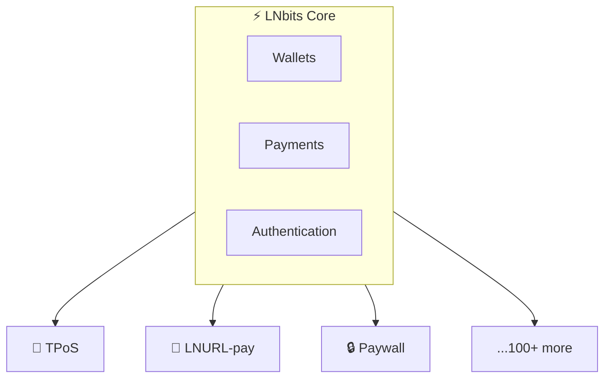

# Extensions Overview

Extensions add powerful features to LNbits without modifying core code.

## What are Extensions?

Extensions are self-contained modules that:
- Add new functionality (TPoS, Paywall, etc.)
- Have their own API endpoints
- Store data in dedicated tables
- Integrate with the wallet system



## Popular Extensions

### Payment & Commerce

| Extension | Purpose | Repository |
|-----------|---------|------------|
| **TPoS** | Point of Sale terminal | [lnbits/tpos](https://github.com/lnbits/tpos) |
| **SatsPay** | Payment processor with webhooks | [lnbits/satspay](https://github.com/lnbits/satspay) |
| **Paywall** | Content monetization | [lnbits/paywall](https://github.com/lnbits/paywall) |
| **Invoices** | Invoice management | [lnbits/invoices](https://github.com/lnbits/invoices) |
| **Offline Shop** | Receive payments offline | [lnbits/offlineshop](https://github.com/lnbits/offlineshop) |
| **TipJar** | Accept tips | [lnbits/tipjar](https://github.com/lnbits/tipjar) |

### LNURL Protocol

| Extension | Purpose | Repository |
|-----------|---------|------------|
| **LNURL-pay** | Static payment links | [lnbits/lnurlp](https://github.com/lnbits/lnurlp) |
| **LNURL-withdraw** | Vouchers and faucets | [lnbits/withdraw](https://github.com/lnbits/withdraw) |
| **LNURLdevice** | Hardware integration | [lnbits/lnurldevice](https://github.com/lnbits/lnurldevice) |
| **Lightning Address** | LN addresses on your domain | [lnbits/lnaddress](https://github.com/lnbits/lnaddress) |
| **LNDhub** | BlueWallet/Zeus compatibility | [lnbits/lndhub](https://github.com/lnbits/lndhub) |

### Swaps & Liquidity

| Extension | Purpose | Repository |
|-----------|---------|------------|
| **Boltz** | Submarine swaps (LN ↔ onchain) | [lnbits/boltz](https://github.com/lnbits/boltz-extension) |
| **Deezy** | LN to onchain swaps | [lnbits/deezy](https://github.com/lnbits/deezy) |
| **Onchain Wallet** | Watch-only BTC wallet | [lnbits/watchonly](https://github.com/lnbits/watchonly) |

### Nostr Integration

| Extension | Purpose | Repository |
|-----------|---------|------------|
| **NOSTR Market** | Decentralized marketplace | [lnbits/nostrmarket](https://github.com/lnbits/nostrmarket) |
| **NOSTR NIP-5** | Sell NIP-05 verification | [lnbits/nostrnip5](https://github.com/lnbits/nostrnip5) |
| **NOSTR Client** | Multi-relay connections | [lnbits/nostrclient](https://github.com/lnbits/nostrclient) |
| **NOSTR Relay** | Run your own relay | [lnbits/nostr-relay](https://github.com/lnbits/nostr-relay-extension) |

### Ecash & Privacy

| Extension | Purpose | Repository |
|-----------|---------|------------|
| **Cashu** | Ecash mint (peg in/out) | [lnbits/cashu](https://github.com/lnbits/cashu) |

### NFC & Hardware

| Extension | Purpose | Repository |
|-----------|---------|------------|
| **BoltCard** | NFC card payments | [lnbits/boltcards](https://github.com/lnbits/boltcards) |
| **Bleskomat** | ATM integration | [lnbits/bleskomat](https://github.com/lnbits/bleskomat) |
| **Gerty** | Bitcoin display device | [lnbits/gerty](https://github.com/lnbits/gerty) |

### Streaming & Content

| Extension | Purpose | Repository |
|-----------|---------|------------|
| **Streamer Copilot** | Streaming tips with animations | [lnbits/copilot](https://github.com/lnbits/copilot) |
| **Stream Alerts** | OBS/streaming integration | [lnbits/livestream](https://github.com/lnbits/livestream) |
| **DJ Livestream** | DJ tips with producer splits | [lnbits/livestream](https://github.com/lnbits/livestream-extension) |
| **Jukebox** | Spotify-powered jukebox | [lnbits/jukebox](https://github.com/lnbits/jukebox) |

### Events & Ticketing

| Extension | Purpose | Repository |
|-----------|---------|------------|
| **Events** | Event ticket sales | [lnbits/events](https://github.com/lnbits/events) |
| **LNticket** | Pay-per-word tickets | [lnbits/lnticket](https://github.com/lnbits/lnticket) |

### Automation & Splitting

| Extension | Purpose | Repository |
|-----------|---------|------------|
| **Split Payments** | Distribute to multiple wallets | [lnbits/splitpayments](https://github.com/lnbits/splitpayments) |
| **Scrub** | Auto-forward to LNURL/wallet | [lnbits/scrub](https://github.com/lnbits/scrub) |

### Bots & Integrations

| Extension | Purpose | Repository |
|-----------|---------|------------|
| **Discord Bot** | Discord wallet integration | [lnbits/discordbot](https://github.com/lnbits/discordbot) |
| **UserManager** | User/wallet management | [lnbits/usermanager](https://github.com/lnbits/usermanager) |

### Gaming & Fun

| Extension | Purpose | Repository |
|-----------|---------|------------|
| **Satsdice** | LNURL-powered dice game | [lnbits/satsdice](https://github.com/lnbits/satsdice) |
| **Hivemind** | Prediction markets | [lnbits/hivemind](https://github.com/lnbits/hivemind) |

### Other

| Extension | Purpose | Repository |
|-----------|---------|------------|
| **Subdomains** | Sell subdomains | [lnbits/subdomains](https://github.com/lnbits/subdomains) |
| **SMTP** | Paid email sending | Built-in |
| **Diagon Alley** | Shop-in-shop system | [lnbits/Diagon-Alley](https://github.com/lnbits/Diagon-Alley) |

## Extension Architecture

Each extension follows a standard structure:

```
extension/
├── manifest.json     # Metadata and version
├── __init__.py       # Extension registration
├── views.py          # Web UI routes
├── views_api.py      # API endpoints
├── models.py         # Data models
├── crud.py           # Database operations
├── migrations.py     # Schema migrations
├── tasks.py          # Background tasks
└── templates/        # HTML templates
    └── extension/
        └── index.html
```

## Managing Extensions

### Via Web UI

1. Go to **Extensions** in sidebar
2. Browse available extensions
3. Click **Enable** to activate
4. Configure in extension settings

### Via Admin UI

Administrators can:
- Install new extensions
- Set default extensions for users
- Disable extensions globally
- Manage extension sources

### Via Environment

```bash
# Default extensions for new users
LNBITS_EXTENSIONS_DEFAULT_INSTALL=tpos,lnurlp

# Disable all extensions
LNBITS_EXTENSIONS_DEACTIVATE_ALL=true
```

## Extension Sources

Extensions are distributed via manifests:

```bash
# Add custom manifest
LNBITS_EXTENSIONS_MANIFESTS="https://example.com/extensions.json"
```

### Official Registry

The official extension registry is at:
- https://extensions.lnbits.com

### Custom Sources

Create your own manifest:

```json
{
  "extensions": [
    {
      "id": "myext",
      "name": "My Extension",
      "version": "1.0.0",
      "archive": "https://github.com/.../myext.zip"
    }
  ]
}
```

## Per-User Extensions

Each user can:
- Enable/disable extensions for themselves
- See only enabled extensions in sidebar
- Have separate extension configurations

## Admin-Only Extensions

Some extensions are restricted to admins:

```json title="manifest.json"
{
  "name": "Admin Tool",
  "admin_only": true
}
```

Examples:
- Server management tools
- Global analytics
- System integrations

## Extension API

Extensions expose APIs at:
```
/api/v1/{extension_id}/...
```

Example (TPoS):
```
GET /api/v1/tpos/
POST /api/v1/tpos/
GET /api/v1/tpos/{tpos_id}
```

## Extension Data

Each extension has isolated tables:

```sql
-- TPoS example
CREATE TABLE tpos (
    id TEXT PRIMARY KEY,
    wallet_id TEXT,
    name TEXT,
    currency TEXT,
    ...
);
```

## Webhooks from Extensions

Extensions can fire webhooks:

```python
# In extension code
await send_webhook(
    url=webhook_url,
    data={"event": "payment_received", ...}
)
```

## Security Model

:::warning Python extensions are not sandboxed
A Python extension runs inside the LNbits process with full access to its database, its settings and every wallet's funds. Installing one means trusting its code as much as LNbits itself. Install only extensions you have reviewed, or from a source you trust.

WASM extensions (new in v1.6.0) run in a sandbox with resource limits and declared permissions.
:::

## Extension Lifecycle

1. **Install** - Downloaded and extracted
2. **Migrate** - Database tables created
3. **Enable** - User activates for wallet
4. **Use** - Extension functions available
5. **Disable** - Hidden but data retained
6. **Uninstall** - Removed (admin)

## See Also

- [Installing Extensions](/docs/extensions/installing)
- [Extension Development](/docs/extensions/development)
- [Extension Manifest](/docs/extensions/manifest)
