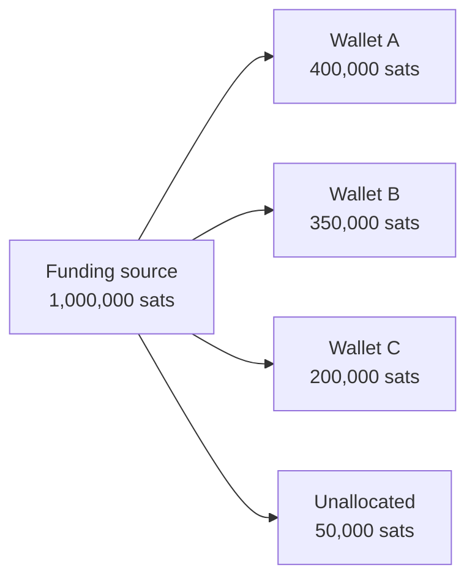

# Funding Sources Overview

A funding source (upstream also calls it a "backend wallet") is the Lightning node or service that actually sends and receives payments. LNbits keeps the accounting: users, wallets, balances and extensions. Every LNbits wallet on an instance is backed by the same single funding source.

A fresh install starts on `VoidWallet`, which can't send or receive anything. You have to pick a real funding source before LNbits is useful.

## How to configure a funding source {#configuration-basics}

:::note The Admin UI is on by default
`LNBITS_ADMIN_UI=true` is the default. After the first start, LNbits stores the funding settings in its database, and **those override `.env`**. So:

- **Normal case:** log in as the Super User, open **Settings → Funding** (`/admin`), pick the source, fill in its fields, save, then restart LNbits (the Admin UI has a restart button). The funding source is loaded at startup, so a restart is needed before the new one is used.
- **`.env`** is only read for funding settings on the very first start, or when you run with `LNBITS_ADMIN_UI=false`. Editing `.env` on an instance that already has saved settings does nothing.
:::

The `.env` form, for a first boot or an instance with the Admin UI turned off:

```bash title=".env"
LNBITS_BACKEND_WALLET_CLASS=LndRestWallet
LND_REST_ENDPOINT=https://127.0.0.1:8080
LND_REST_CERT=/home/lnbits/lnd/tls.cert
LND_REST_MACAROON=/home/lnbits/lnd/admin.macaroon
```

The Admin UI only offers the classes listed in `LNBITS_ALLOWED_FUNDING_SOURCES`. That setting is read from `.env` only. Its default leaves out `SparkWallet` and `ClicheWallet`, so add them there if you need them.

## Every funding source in v1.6.2 {#available-funding-sources}

These are all the classes exported by `lnbits/wallets/__init__.py` in v1.6.2. "Self-custodial node" means you run a full Lightning node. "Self-custodial service" means you hold the keys but depend on someone else's infrastructure (an LSP, an L2 operator, a swap service). "Custodial" means a third party holds the funds.

| Class (`LNBITS_BACKEND_WALLET_CLASS`) | What it connects to | Type | Status (Oct 2026) | Settings | Page |
|---|---|---|---|---|---|
| `LndRestWallet` | LND, REST API | Self-custodial node | Active | `LND_REST_*` | [LND](/docs/funding-sources/lnd) |
| `LndWallet` | LND, gRPC | Self-custodial node | Active | `LND_GRPC_*` | [LND](/docs/funding-sources/lnd) |
| `CLNRestWallet` | Core Lightning, built-in `clnrest` with runes | Self-custodial node | Active, the recommended CLN option | `CLNREST_*` | [Core Lightning](/docs/funding-sources/cln) |
| `CoreLightningWallet` | Core Lightning, local RPC socket | Self-custodial node | Active | `CORELIGHTNING_*` | [Core Lightning](/docs/funding-sources/cln) |
| `CLightningWallet` | Old name for `CoreLightningWallet`, kept for old configs | Self-custodial node | Alias | `CLIGHTNING_RPC` | [Core Lightning](/docs/funding-sources/cln) |
| `CoreLightningRestWallet` | Core Lightning via RTL's c-lightning-REST | Self-custodial node | **Deprecated**: c-lightning-REST archived 2026-07 | `CORELIGHTNING_REST_*` | [Core Lightning](/docs/funding-sources/cln) |
| `EclairWallet` | Eclair (ACINQ) | Self-custodial node | Active | `ECLAIR_*` | [Other backends](/docs/funding-sources/others) |
| `SparkWallet` | Spark web wallet for Core Lightning (not Spark L2) | Self-custodial node | Legacy; not in the default allowed list | `SPARK_URL`, `SPARK_TOKEN` | [Other backends](/docs/funding-sources/others) |
| `PhoenixdWallet` | ACINQ phoenixd | Self-custodial service (ACINQ as LSP) | Active | `PHOENIXD_*` | [Phoenixd](/docs/funding-sources/phoenixd) |
| `SparkL2Wallet` | Spark L2 network, through the LNbits sidecar | Self-custodial service | Active; Spark mainnet is beta | `SPARK_L2_*` | [Other backends](/docs/funding-sources/others) |
| `BarkWallet` | Ark, through Second's `barkd` | Self-custodial service | New in v1.6.0 | `BARK_*` | [Other backends](/docs/funding-sources/others) |
| `BoltzWallet` | boltz-client, Liquid swaps | Self-custodial service | Active | `BOLTZ_*` | [Other backends](/docs/funding-sources/others) |
| `BreezSdkWallet` | Breez SDK (Greenlight) | Self-custodial service | **Deprecated** by Breez | `BREEZ_*` | [Other backends](/docs/funding-sources/others) |
| `BreezLiquidSdkWallet` | Breez SDK (Liquid) | Self-custodial service | **Deprecated** by Breez | `BREEZ_LIQUID_*` | [Other backends](/docs/funding-sources/others) |
| `ClicheWallet` | fiatjaf's Cliche | Self-custodial service | **Unmaintained** (last release 2022); not in the default allowed list | `CLICHE_ENDPOINT` | [Other backends](/docs/funding-sources/others) |
| `NWCWallet` | Any Nostr Wallet Connect wallet, e.g. Alby Hub | Depends on the wallet behind it | Active | `NWC_PAIRING_URL` | [Custodial services](/docs/funding-sources/custodial) |
| `LNbitsWallet` | A wallet on another LNbits instance | Custodial (the other instance holds the funds) | Active | `LNBITS_ENDPOINT`, `LNBITS_KEY` | [Custodial services](/docs/funding-sources/custodial) |
| `BlinkWallet` | Blink | Custodial | Active | `BLINK_*` | [Custodial services](/docs/funding-sources/custodial) |
| `StrikeWallet` | Strike | Custodial | Active | `STRIKE_*` | [Custodial services](/docs/funding-sources/custodial) |
| `ZBDWallet` | ZBD | Custodial | Active | `ZBD_*` | [Custodial services](/docs/funding-sources/custodial) |
| `OpenNodeWallet` | OpenNode | Custodial | Active | `OPENNODE_*` | [Custodial services](/docs/funding-sources/custodial) |
| `AlbyWallet` | Alby's hosted wallet API | Custodial | **Shut down**: shared wallet closed 2025-01-04 | `ALBY_*` | [Custodial services](/docs/funding-sources/custodial) |
| `LNPayWallet` | LNPay | Custodial | **Dead**: API host doesn't resolve | `LNPAY_*` | [Custodial services](/docs/funding-sources/custodial) |
| `LnTipsWallet` | LN.tips | Custodial | **Dead**: domain doesn't resolve | `LNTIPS_*` | [Custodial services](/docs/funding-sources/custodial) |
| `FakeWallet` | Nothing: mints test balances | Testing | Testing only | `FAKE_WALLET_SECRET` | [Fake Wallet](/docs/funding-sources/fake-wallet) |
| `VoidWallet` | Nothing | None | The default; can't send or receive | none | This page |

:::caution Don't start new installs on the deprecated or dead backends
`AlbyWallet`, `LNPayWallet`, `LnTipsWallet`, `CoreLightningRestWallet`, `BreezSdkWallet`, `BreezLiquidSdkWallet` and `ClicheWallet` still ship in v1.6.2, but the services or SDKs behind them are gone, archived or unmaintained. If you're on one of them, plan a move (see [switching](#switching-funding-sources)). Status is as of October 2026. LNPay and LN.tips are marked dead because their hosts no longer resolve, not because of an official notice.
:::

Card payments (Stripe, PayPal, Square, Revolut) aren't funding sources. They work alongside one; see [Fiat providers](/docs/funding-sources/fiat-providers).

## Choosing a funding source {#choosing-a-funding-source}

| You want | Use |
|---|---|
| You already run a Lightning node | [LND](/docs/funding-sources/lnd) or [Core Lightning](/docs/funding-sources/cln) (`CLNRestWallet`) |
| Self-custody without managing channels | [Phoenixd](/docs/funding-sources/phoenixd). ACINQ opens channels for you, for a fee |
| Self-custody for small amounts, no channels at all | Spark L2 or Bark (see [Other backends](/docs/funding-sources/others)). Both are young; treat them as beta |
| You run Alby Hub, or another wallet with NWC | `NWCWallet` (see [Custodial services](/docs/funding-sources/custodial)) |
| No infrastructure at all, and you accept a custodian | Blink, Strike, ZBD or OpenNode (see [Custodial services](/docs/funding-sources/custodial)) |
| Development, demos, tests | [Fake Wallet](/docs/funding-sources/fake-wallet) |

Things to weigh:

- **Custody.** With a custodial backend, the provider holds every sat in every LNbits wallet on your instance. They can freeze it, and their KYC and country rules apply to you.
- **Operations.** A full node means channel and liquidity management and backups. Phoenixd, Spark L2 and Bark trade some of that away for dependence on an operator.
- **Fees.** Swap-based and L2 backends (Boltz, Bark, Spark L2, Breez Liquid) often need a larger fee reserve than the default; see below.

## Funding settings worth knowing {#funding-settings}

These live under **Settings → Funding** in the Admin UI (or in `.env` before the first start):

| Setting | Default | What it does |
|---|---|---|
| `LNBITS_RESERVE_FEE_MIN` | `2000` (msat) | Minimum routing-fee reserve LNbits holds back on an outgoing payment |
| `LNBITS_RESERVE_FEE_PERCENT` | `1.0` | Reserve as a percentage of the amount; the larger of the two is used |
| `LNBITS_FUNDING_SOURCE_PAY_INVOICE_WAIT_SECONDS` | `5` | How long a payment call waits before LNbits reports the payment as pending (it doesn't fail it) |
| `FUNDING_SOURCE_MAX_RETRIES` | `4` | Connection attempts at startup. If they all fail, LNbits falls back to `VoidWallet` until the next restart |
| `LNBITS_WATCHDOG_SWITCH_TO_VOIDWALLET` | `false` | If the LNbits balances exceed the funding-source balance by more than `LNBITS_WATCHDOG_DELTA` sats (default 1,000,000), switch to `VoidWallet` |
| `LNBITS_NOTIFICATION_WATCHDOG` | `false` | Same check, but only notify the admins. The watchdog does nothing unless one of these two is on |
| `LNBITS_NODE_UI` | `false` | Node management page, for the backends that support it in v1.6.2: `LndRestWallet`, `CoreLightningWallet` and `PhoenixdWallet` |

If small payments fail with an error like `fee of 20000 msat exceeds limit of 5000 msat`, raise `LNBITS_RESERVE_FEE_MIN`. Upstream gives this advice for Bark and Breez Liquid, and it applies to the other swap-based backends too.

## Testing the connection {#testing-your-connection}

- **Admin UI:** **Settings → Funding** shows the current funding source and its balance.
- **API:** `GET /api/v1/status` reports `funding_source`, `funding_source_error` and `funding_source_balance_msat`, but only to an admin user (send your bearer token or session cookie). Anyone else gets only the version and uptime.
- `GET /api/v1/health` only returns the server time and uptime. It doesn't test the funding source.
- **Logs:** a backend that can't connect logs the reason (for example, a missing rune or certificate) on each attempt. After `FUNDING_SOURCE_MAX_RETRIES` failed attempts, LNbits logs `Fallback to VoidWallet` and keeps running on `VoidWallet`, so the instance is up but no payment works.

Then create a small invoice and pay it from another wallet.

## Switching funding sources {#switching-funding-sources}

1. Make sure the new backend holds at least as many sats as the sum of all LNbits wallet balances. LNbits balances are numbers in its database; they don't move with you.
2. In **Settings → Funding**, select the new source, enter its credentials, save, and restart.
3. Check the status (above) and make a test payment in both directions.

:::warning
Switching affects every wallet on the instance at once. If the new backend has fewer sats than LNbits thinks its users own, the last users to withdraw can't.
:::

## Balance reconciliation {#balance-reconciliation}

The sum of all LNbits wallet balances should never exceed what the funding source actually holds:



Watch for discrepancies. The watchdog (off by default) can notify you when the gap grows too large, or stop payments by switching to `VoidWallet`.

## Common issues {#common-issues}

- **LNbits runs on VoidWallet although you configured something else.** The backend failed its startup connection attempts and LNbits fell back. Fix the cause shown in the logs, then restart.
- **Your `.env` changes have no effect.** The Admin UI already has saved settings, and they win. Change the source in **Settings → Funding** instead.
- **The backend doesn't connect.** Check the logs for the reason. Then check the endpoint URL and port, the credential (macaroon, rune, token) and the TLS certificate. Paths in `.env` must be absolute, because `~` isn't expanded.
- **Small payments fail.** Raise the fee reserve (above).
- **Payments stay pending.** The backend accepted the payment but hasn't settled it yet. Check the node's own logs before you retry.

## See also

- [LND](/docs/funding-sources/lnd)
- [Core Lightning](/docs/funding-sources/cln)
- [Phoenixd](/docs/funding-sources/phoenixd)
- [Custodial services](/docs/funding-sources/custodial)
- [Other backends](/docs/funding-sources/others)
- [Fiat providers](/docs/funding-sources/fiat-providers)
- Upstream docs: [docs.lnbits.com](https://docs.lnbits.com)
