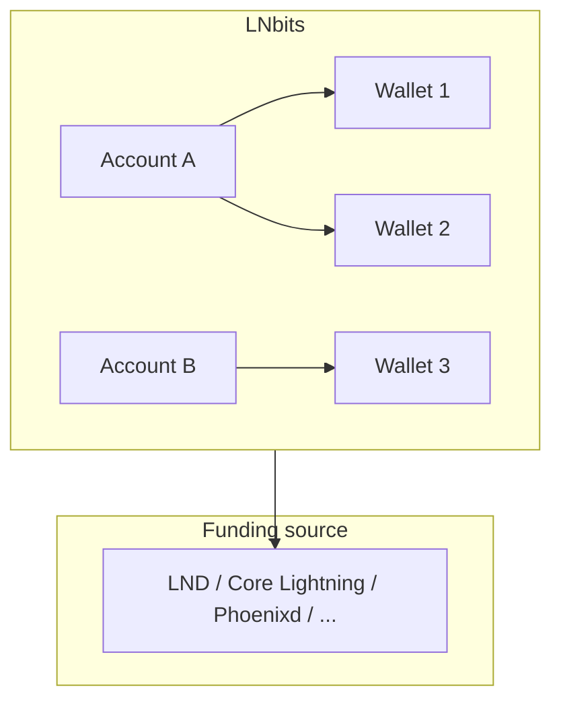

# Introduction to LNbits

LNbits is a free, open-source (MIT) Lightning accounts system. It sits on top of one Lightning funding source and adds user accounts, wallets with their own balances and API keys, a REST API, and extensions.

:::tip Current release: v1.6.2 (2026-09-18)
These pages are checked against LNbits **v1.6.2**. v1.6.0 added sandboxed WASM extensions, Lightning Addresses in core wallets, a block explorer and the Bark funding source. v1.6.2 is a hotfix for the PostgreSQL backup. The official docs are at [docs.lnbits.com](https://docs.lnbits.com). This site is an independent, self-host-focused companion.
:::

## What is LNbits? {#what-is-lnbits}

Think of LNbits as a **Lightning wallet multiplexer**. You connect it to a single Lightning node or service (the "funding source"), and LNbits keeps many separate wallet accounts on top of it:

- **Accounts** log in (by default with a username and password) and can hold several wallets.
- **Wallets** each have their own balance, kept in LNbits' own ledger in millisatoshis, and their own pair of API keys (an admin key and an invoice key).
- **Extensions** are enabled per account and add features such as point of sale, pay links and paywalls.

All wallets share the funding source's liquidity. LNbits is therefore **custodial**: whoever runs the instance controls the funds in every wallet on it.

## Key Features {#key-features}

### Accounts and wallets {#multi-wallet-system}

An account can hold as many wallets as it likes, each with its own balance, keys and history. A wallet can also be shared with another user on the same instance, with view, receive or send rights.

### Funding sources {#24-funding-sources}

LNbits v1.6.2 ships about 25 funding source classes ([wallets/\_\_init\_\_.py](https://github.com/lnbits/lnbits/blob/v1.6.2/lnbits/wallets/__init__.py)):

- **Your own node:** LND (REST and gRPC), Core Lightning (CLNRest and RPC), Eclair, Phoenixd
- **Services and other backends:** Blink, ZBD, OpenNode, Strike, NWC (Nostr Wallet Connect), Spark L2, Bark, Boltz
- **Nested:** another LNbits instance
- **Testing:** FakeWallet. A fresh install starts on **VoidWallet**, which can't send or receive.

Some older options have since died or been deprecated (the Alby shared wallet, LNPay, LN.tips, c-lightning-REST, Breez Greenlight and Liquid). See [Funding Sources](/docs/funding-sources/overview).

### Extensions {#100-extensions}

The official registry lists about 60 Python extensions, and a separate registry lists about 20 WASM extensions. They include TPoS (point of sale), LNURLp (pay links and Lightning Addresses), Paywall, Withdraw and many more. Python extensions run inside the LNbits process with full access. WASM extensions (since v1.6.0) run in a sandbox. For the catalogue, see [docs.lnbits.com](https://docs.lnbits.com/guide/using-extensions).

### For developers {#developer-friendly}

- A REST API with OpenAPI docs at `/docs` on every instance
- Webhooks and websockets for payment updates
- LNURL support
- An extension framework (Python, or sandboxed WASM)

### For operators {#production-ready}

- Docker, uv, AppImage and Nix installs
- SQLite by default, with PostgreSQL for busy instances
- An Admin UI (on by default) for funding, users, extensions and settings
- An audit log, rate limits and wallet limits

## Use Cases {#use-cases}

Shops (TPoS, see the official [merchant stack](https://docs.lnbits.com/merchant-stack/)), apps that create invoices and receive webhooks through the [API](/docs/api/overview), community wallets on a shared node, paywalls and pay links, and teaching with FakeWallet. More in [Use Cases](/docs/guides/use-cases).

## Architecture Overview {#architecture-overview}

| Component | Technology |
|---|---|
| Backend | Python 3.10 to 3.12 (`>=3.10,<3.13`), FastAPI. The Docker image uses Python 3.12. |
| Database | SQLite (default), PostgreSQL, CockroachDB |
| Frontend | Vue 3, Quasar |
| API | REST, with OpenAPI/Swagger docs |

More in [Architecture](/docs/architecture/overview).

## Getting Started {#getting-started}

1. **[Installation](/docs/getting-started/installation):** install LNbits with uv, Docker, the AppImage or Nix.
2. **[Quick Start](/docs/getting-started/quick-start):** first start, the Super User, and a FakeWallet test.
3. **[Create Your First Wallet](/docs/getting-started/first-wallet):** wallets, keys and payments.

## Community & Support {#community--support}

- **Official docs:** [docs.lnbits.com](https://docs.lnbits.com)
- **Demo:** [demo.lnbits.com](https://demo.lnbits.com). It's a public test server, so don't keep real funds there.
- **Telegram:** [t.me/lnbits](https://t.me/lnbits)
- **GitHub:** [github.com/lnbits/lnbits](https://github.com/lnbits/lnbits)

## License {#license}

LNbits is released under the [MIT License](https://github.com/lnbits/lnbits/blob/v1.6.2/LICENSE).
