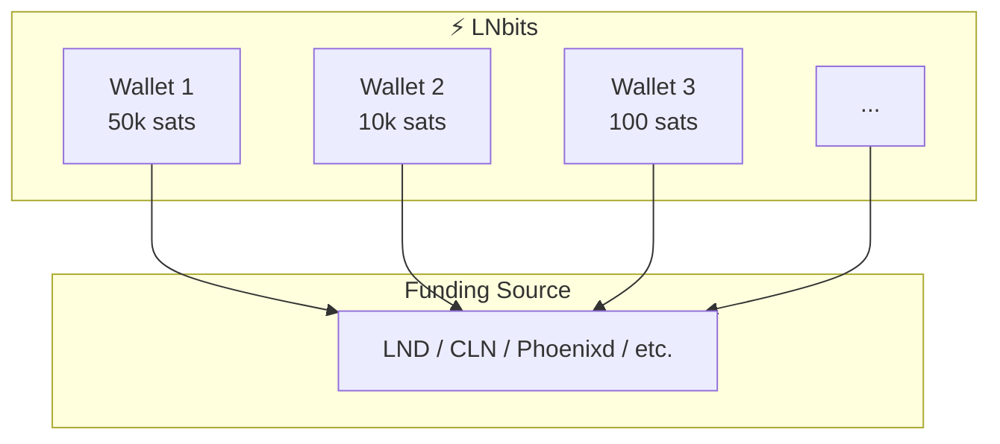

# Introduction to LNbits

LNbits is a free, open-source Lightning Network accounts system with a powerful extension framework. It acts as a layer on top of your Lightning funding source, providing isolated wallet accounts, a clean REST API, and modular extensions.

:::tip LNbits v1.0.0 Released
After five years and 6,000+ commits, LNbits reached v1.0.0 in April 2025. The software is now **stable, hardened, and production-ready** with Vue 3, WebSocket payments, Nostr login, and Access Control Lists.
:::

## What is LNbits?

Think of LNbits as a **Lightning wallet multiplexer**. You connect it to a single Lightning node or custodial service (the "funding source"), and LNbits creates multiple isolated wallet accounts on top. Each wallet has:

- Its own balance (tracked internally)
- Separate API keys (admin key and invoice key)
- Independent permissions
- Custom extensions enabled/disabled per wallet

## Key Features

### Multi-Wallet System
Create unlimited wallets with isolated balances. Perfect for:
- Running a custodial service for your community
- Separating funds for different projects
- Testing without risking real funds

### 24+ Funding Sources
Connect to virtually any Lightning backend:
- **Self-hosted**: LND, Core Lightning, Phoenixd, Eclair
- **Custodial**: Alby, OpenNode, Blink, ZBD
- **Nested**: Use another LNbits instance as a funding source
- **Testing**: Fake Wallet for development

### 100+ Extensions
Extend functionality without touching code:
- **TPoS**: Point-of-sale for merchants
- **LNURL-pay**: Lightning Addresses and static QR codes
- **Paywall**: Monetize content with Lightning
- **Jukebox**: Let customers pay to play music
- And many more...

### Developer Friendly
Build Lightning apps with ease:
- Clean REST API with OpenAPI documentation
- Webhook support for real-time notifications
- LNURL protocol support
- Python SDK for extensions

### Production Ready
Deploy with confidence:
- Docker and systemd deployment options
- PostgreSQL for high-load environments
- Admin UI for instance management
- Audit logs for compliance

## Use Cases

### For Merchants
Accept Bitcoin payments at your store with the TPoS extension. Generate QR codes, handle NFC payments, and print receipts.

### For Developers
Build Lightning-enabled applications using the LNbits API. Create invoices, check payments, and handle webhooks.

### For Communities
Run a custodial wallet service for your community. Each member gets their own wallet with isolated funds.

### For Content Creators
Monetize your content with paywalls. Unlock articles, videos, or downloads for Lightning micropayments.

### For Educators
Teach Lightning Network concepts with a safe, sandboxed environment. Use the Fake Wallet for risk-free testing.

## Architecture Overview

LNbits is built with modern technologies:

| Component | Technology |
|-----------|------------|
| Backend | Python 3.10+, FastAPI |
| Database | SQLite, PostgreSQL, CockroachDB |
| Frontend | Vue.js, Quasar Framework |
| API | REST with OpenAPI/Swagger docs |

## Getting Started

Ready to dive in? Here's your path:

1. **[Installation](/docs/getting-started/installation)** - Set up LNbits on your machine
2. **[Quick Start](/docs/getting-started/quick-start)** - Get running in 5 minutes
3. **[Create Your First Wallet](/docs/getting-started/first-wallet)** - Start using LNbits

## Community & Support

- **Demo**: Try LNbits at [demo.lnbits.com](https://demo.lnbits.com)
- **Telegram**: Join the community at [t.me/lnbits](https://t.me/lnbits)
- **GitHub**: Contribute at [github.com/lnbits/lnbits](https://github.com/lnbits/lnbits)
- **Documentation**: You're already here!

## License

LNbits is released under the [MIT License](https://opensource.org/licenses/MIT). Free to use, modify, and distribute.
