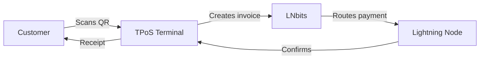
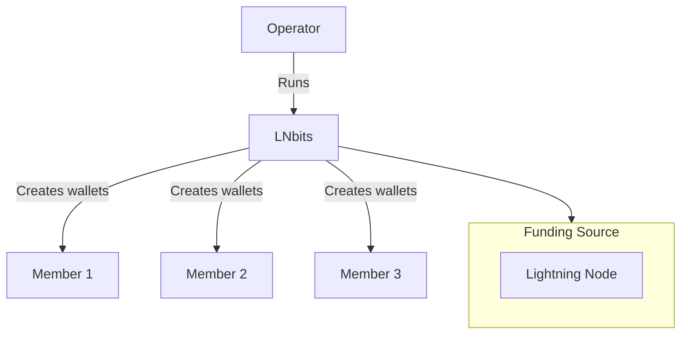
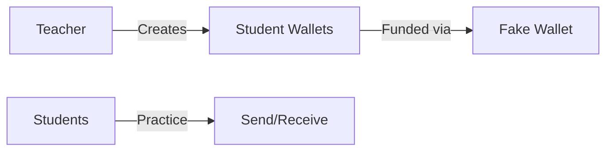
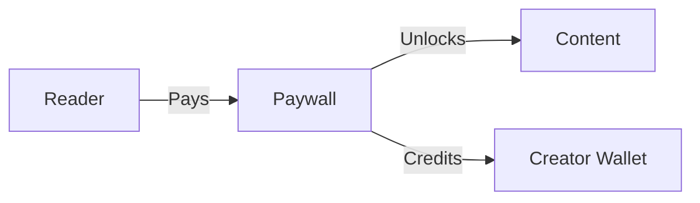
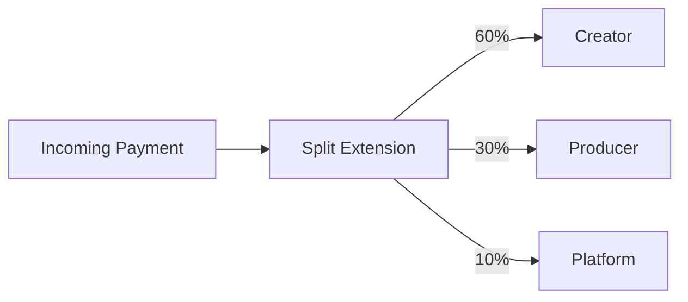
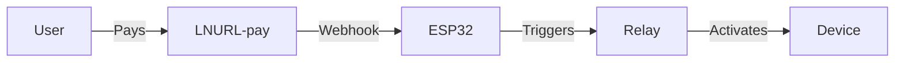

# Use Cases

LNbits powers a wide range of applications from merchant payments to educational tools.

## For Merchants

### Point of Sale

Accept Bitcoin at your physical location:



**Extensions:** TPoS, Offline Shop, SatsPay

**Real deployments:**
- Burger trucks and food stalls
- Barbershops and salons
- Cafes and bars
- Market vendors

### E-Commerce

Integrate Lightning payments into your online store:

- **WooCommerce**: Use the [LNbits Payment Gateway](https://wordpress.org/plugins/lnbits-payment-gateway/) plugin
- **Custom**: Integrate via REST API with webhooks
- **SatsPay**: Create payment links with expiration

### Subscription Services

Recurring payments for content or services:

1. Create static LNURL-pay link
2. Customer pays monthly
3. Webhook triggers access renewal

---

## For Communities

### Community Bank

Run a custodial wallet service for your group:



**Use cases:**
- Family Bitcoin banks
- Local Bitcoin meetup groups
- Company expense wallets
- Church/organization donations

**Extensions:** UserManager, Split Payments

### Voucher Distribution

Distribute sats without requiring recipients to have wallets:

1. Create LNURL-withdraw vouchers
2. Print QR codes or write to NFC cards
3. Recipients scan to claim funds
4. Works with any Lightning wallet

**Popular at:**
- Conferences and meetups
- Educational workshops
- Marketing campaigns
- Tips and gifts

---

## For Educators

### Classroom Bitcoin

Teach Lightning Network with hands-on experience:



**Setup:**
1. Use Fake Wallet (no real funds)
2. Create wallet per student
3. Students practice payments
4. No risk, full functionality

**Extensions:** UserManager, TPoS, LNURL-pay

### Workshop Funding

For real-funds workshops:

1. Create voucher batch
2. Distribute to participants
3. Participants claim and experiment
4. Remaining funds can be swept

---

## For Content Creators

### Paywalled Content

Monetize articles, videos, or downloads:



**Implementations:**
- Blog posts (WordPress plugin)
- PDF downloads
- Video streaming
- API access

### Streaming Tips

Receive tips during livestreams:

1. Install Streamer Copilot extension
2. Connect to OBS/streaming software
3. Display tip animations on stream
4. Automatic thank-you messages

**Extensions:** Streamer Copilot, Stream Alerts, DJ Livestream

### Revenue Splitting

Automatic splits between collaborators:



**Use cases:**
- Podcast hosts and guests
- Band members
- Co-authors
- Affiliate revenue

---

## For Developers

### API Backend

Use LNbits as your Lightning backend:

```python
import httpx

# Create invoice
response = httpx.post(
    "https://your-lnbits.com/api/v1/payments",
    headers={"X-Api-Key": invoice_key},
    json={"out": False, "amount": 1000, "memo": "API payment"}
)
invoice = response.json()

# Check payment status
status = httpx.get(
    f"https://your-lnbits.com/api/v1/payments/{invoice['payment_hash']}",
    headers={"X-Api-Key": invoice_key}
)
```

### Webhook Integration

Real-time payment notifications:

```python
@app.post("/webhook")
async def payment_webhook(data: dict):
    if data["status"] == "success":
        # Grant access, ship product, etc.
        await fulfill_order(data["payment_hash"])
```

### Test Environment

Develop without real funds:

```bash
# Use Fake Wallet for testing
LNBITS_BACKEND_WALLET_CLASS=FakeWallet
```

---

## For Hardware Projects

### NFC Payments

Enable tap-to-pay with BoltCards:

1. Install BoltCard extension
2. Program NFC cards with credentials
3. Tap to pay at any LNbits TPoS
4. Works with rings, cards, badges

**Hardware:** NXP NTAG 424 DNA cards

### Bitcoin ATMs

Build your own Lightning ATM:

**Projects:**
- [Fossa ATM](https://github.com/lnbits/fossa) - Full ATM with display
- [LightningATM](https://github.com/21isenough/LightningATM) - Raspberry Pi based
- [Bleskomat](https://www.bleskomat.com/) - Commercial option

### Vending Machines

Accept Lightning for physical goods:

1. ESP32 + relay module
2. LNURLdevice extension
3. Customer scans, pays, relay triggers
4. Dispense product

**Examples:**
- Candy dispensers
- Coffee machines
- Beer taps
- Arcade games

### IoT Switches

Pay-to-activate devices:



**Real projects:**
- LED light shows
- Pet feeders
- Door locks
- Charging stations

---

## For Nostr Users

### Nostr Marketplace

Sell products on decentralized marketplaces:

1. Install NOSTR Market extension
2. List products with prices
3. Connect to Nostr relays
4. Customers purchase via DMs

### NIP-05 Verification

Sell verification identities:

1. Own a domain
2. Install NOSTR NIP-5 extension
3. Users pay for `user@yourdomain.com`
4. Automatic `.well-known/nostr.json` updates

### Zap Integration

Receive zaps directly to your LNbits wallet via Nostr Wallet Connect (NWC).

---

## Liquidity Management

### Lightning to On-Chain

Free up channel capacity:

1. Receive Lightning payments
2. Use Boltz/Deezy to swap to on-chain
3. Channel capacity restored
4. On-chain funds in cold storage

### Automatic Forwarding

Sweep funds automatically:


---

## See Also

- [Extensions Overview](/docs/extensions/overview)
- [Resources](/docs/resources) - Community tutorials and guides
- [API Reference](/docs/api/overview)
