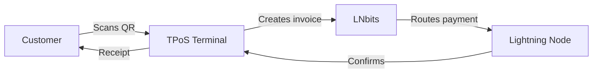
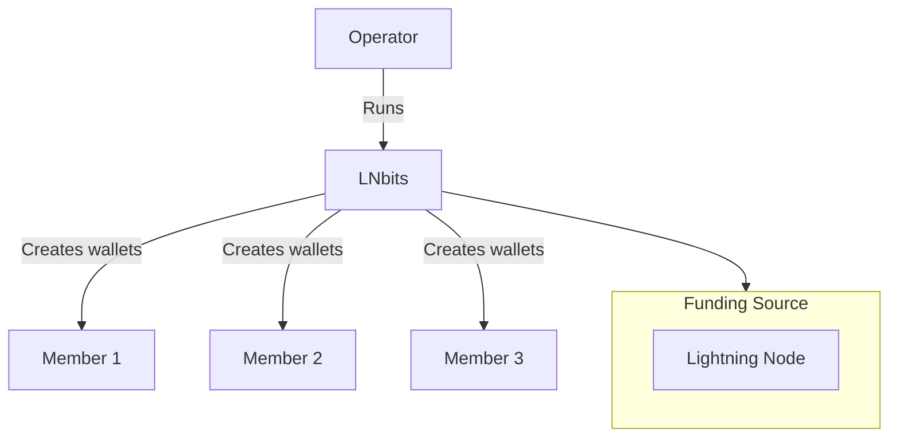
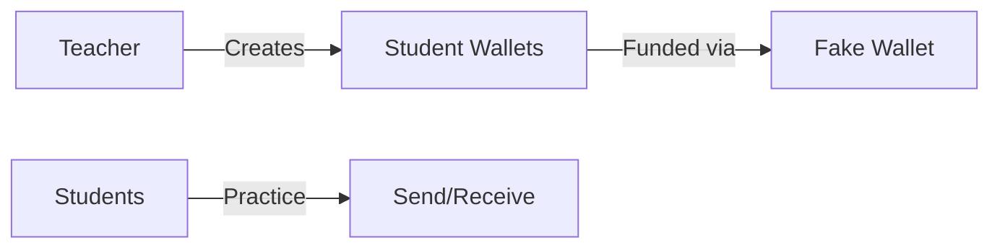
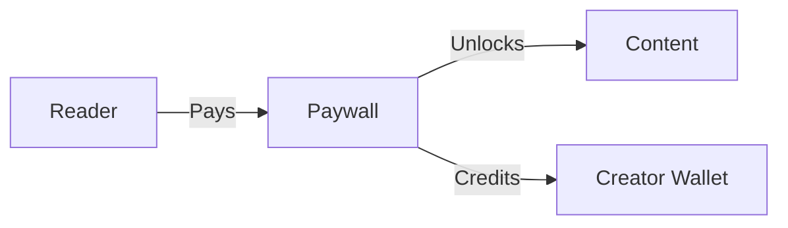
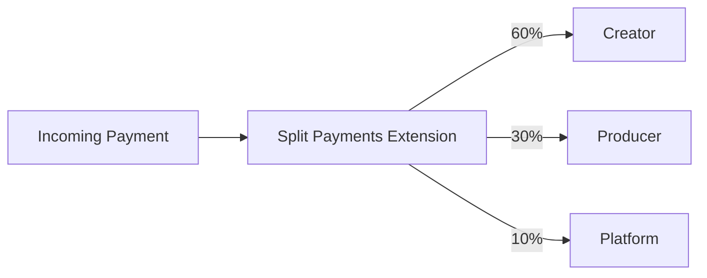
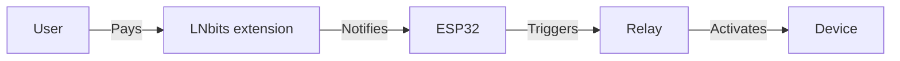
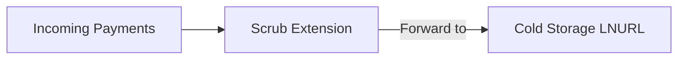

# Use Cases

LNbits powers a wide range of applications from merchant payments to educational tools. Most of them use extensions. For each extension's own guide, see the [official extension docs](https://docs.lnbits.com).

:::caution Python extensions are not sandboxed
Python extensions run inside the LNbits process with full access to its database and funds. Install only extensions you trust. WASM extensions (since v1.6.0) run sandboxed with the permissions you grant at install time.
:::

## For Merchants

### Point of Sale

Accept Bitcoin at your physical location:



**Extensions:** TPoS, Offline Shop, SatsPay

**Real deployments:**
- Burger trucks and food stalls
- Barbershops and salons
- Cafes and bars
- Market vendors

### E-Commerce

Integrate Lightning payments into your online store:

- **WooCommerce**: Use the [LNbits Payment Gateway](https://wordpress.org/plugins/lnbits-bitcoin-onchain-and-lightning-payment-gateway/) plugin
- **Custom**: Integrate via REST API with webhooks
- **SatsPay**: Create payment links with expiration

### Subscription Services

Recurring payments for content or services:

1. Create a static LNURL-pay link (LNURLp extension) or give each customer a wallet [Lightning Address](/docs/guides/lightning-addresses)
2. Customer pays monthly
3. Your backend sees the payment (webhook or polling) and renews access

---

## For Communities

### Community Bank

Run a custodial wallet service for your group:



**Use cases:**
- Family Bitcoin banks
- Local Bitcoin meetup groups
- Company expense wallets
- Church/organization donations

**Extensions:** UserManager, Split Payments. Every wallet can also have its own [Lightning Address](/docs/guides/lightning-addresses) (since v1.6.0), so members can receive without an extension.

### Voucher Distribution

Distribute sats without requiring recipients to have wallets:

1. Create LNURL-withdraw vouchers (Withdraw extension)
2. Print QR codes or write to NFC cards
3. Recipients scan to claim funds
4. Works with any Lightning wallet

**Popular at:**
- Conferences and meetups
- Educational workshops
- Marketing campaigns
- Tips and gifts

---

## For Educators

### Classroom Bitcoin

Teach Lightning Network with hands-on experience:



**Setup:**
1. Use FakeWallet (no real funds)
2. Create a wallet per student
3. Students practice payments between their wallets
4. No risk. FakeWallet can only pay invoices it issued itself, so payments to outside wallets fail

**Extensions:** UserManager, TPoS, LNURLp

### Workshop Funding

For real-funds workshops:

1. Create voucher batch
2. Distribute to participants
3. Participants claim and experiment
4. Remaining funds can be swept

---

## For Content Creators

### Paywalled Content

Monetize articles, videos, or downloads:



**Implementations:**
- Paywall extension for links and files
- Blog posts (WordPress plugin)
- PDF downloads
- Video streaming
- API access

### Streaming Tips

Receive tips during livestreams:

1. Install Streamer Copilot extension
2. Connect to OBS/streaming software
3. Display tip animations on stream
4. Automatic thank-you messages

**Extensions:** Streamer Copilot (`copilot`), Stream Alerts (`streamalerts`), DJ Livestream (`livestream`)

### Revenue Splitting

Automatic splits between collaborators:



**Use cases:**
- Podcast hosts and guests
- Band members
- Co-authors
- Affiliate revenue

---

## For Developers

### API Backend

Use LNbits as your Lightning backend:

```python
import httpx

# Create invoice. "out": False is required: without it the request tries to pay.
response = httpx.post(
    "https://your-lnbits.example/api/v1/payments",
    headers={"X-Api-Key": invoice_key},
    json={"out": False, "amount": 1000, "memo": "API payment"}
)
invoice = response.json()  # a Payment, with "payment_hash" and "bolt11"

# Check payment status: {"paid": true/false, ...}
status = httpx.get(
    f"https://your-lnbits.example/api/v1/payments/{invoice['payment_hash']}",
    headers={"X-Api-Key": invoice_key}
).json()
```

### Webhook Integration

Set `"webhook": "https://your-app.example/webhook"` when you create the invoice. LNbits POSTs the paid Payment once, when the invoice is paid. In v1.6.2 the body is the Payment encoded as a JSON **string** (it is JSON-encoded twice), and amounts are in msat:

```python
import json
from fastapi import Request

@app.post("/webhook")
async def payment_webhook(request: Request):
    data = await request.json()
    if isinstance(data, str):  # v1.6.2 sends a JSON-encoded string
        data = json.loads(data)
    if data["status"] == "success":
        # Grant access, ship product, etc. Make this idempotent:
        # the same payment can be delivered more than once.
        await fulfill_order(data["payment_hash"])
```

Don't trust the webhook alone: confirm with `GET /api/v1/payments/{payment_hash}` before you ship anything. Webhooks to private or LAN addresses are blocked unless `LNBITS_CALLBACK_ALLOW_PRIVATE_IPS=true`.

### Test Environment

Develop without real funds:

```bash
# Use FakeWallet for testing (the default funding source is VoidWallet)
LNBITS_BACKEND_WALLET_CLASS=FakeWallet
```

With the Admin UI on (the default), the funding source saved in the database overrides `.env` after the first start. Switch it in `/admin`.

---

## For Hardware Projects

### NFC Payments

Enable tap-to-pay with BoltCards:

1. Install the Bolt Cards extension (`boltcards`)
2. Program NFC cards with credentials
3. Tap to pay at any LNbits TPoS
4. Works with rings, cards, badges

**Hardware:** NXP NTAG 424 DNA cards

### Bitcoin ATMs

Build your own Lightning ATM:

**Projects:**
- [Fossa ATM](https://github.com/lnbits/fossa) - Full ATM with display
- [LightningATM](https://github.com/21isenough/LightningATM) - Raspberry Pi based
- [Bleskomat](https://www.bleskomat.com/) - Commercial option

### Vending Machines

Accept Lightning for physical goods:

1. ESP32 + relay module
2. LNURLdevice or Bitcoin Switch extension
3. Customer scans, pays, relay triggers
4. Dispense product

**Examples:**
- Candy dispensers
- Coffee machines
- Beer taps
- Arcade games

### IoT Switches

Pay-to-activate devices:



If the device sits on your LAN and you use a plain webhook, LNbits blocks it unless `LNBITS_CALLBACK_ALLOW_PRIVATE_IPS=true`.

**Real projects:**
- LED light shows
- Pet feeders
- Door locks
- Charging stations

---

## For Nostr Users

### Nostr Marketplace

Sell products on decentralized marketplaces:

1. Install the Nostr Market extension (`nostrmarket`)
2. List products with prices
3. Connect to Nostr relays
4. Customers purchase via DMs

### NIP-05 Verification

Sell verification identities:

1. Own a domain
2. Install the Nostr NIP-5 extension (`nostrnip5`)
3. Users pay for `user@yourdomain.com`
4. Automatic `.well-known/nostr.json` updates

### Nostr Wallet Connect {#zap-integration}

Connect a Nostr client to your LNbits wallet with Nostr Wallet Connect (NWC) through the NWC Service Provider extension (`nwcprovider`).

---

## Liquidity Management

### Lightning to On-Chain

Free up channel capacity:

1. Receive Lightning payments
2. Use the Boltz extension to swap to on-chain
3. Channel capacity restored
4. On-chain funds in cold storage

### Automatic Forwarding

Sweep funds automatically:



---

## See Also

- [Extensions Overview](/docs/extensions/overview)
- [Resources](/docs/resources) - Community tutorials and guides
- [API Reference](/docs/api/overview)
